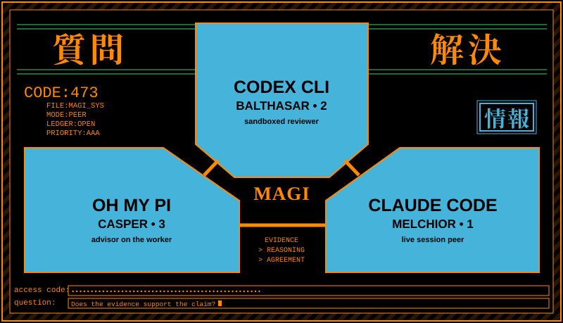
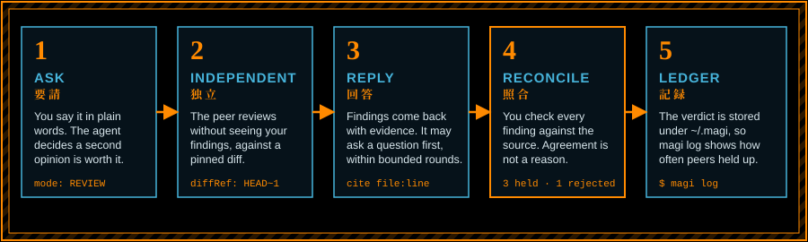
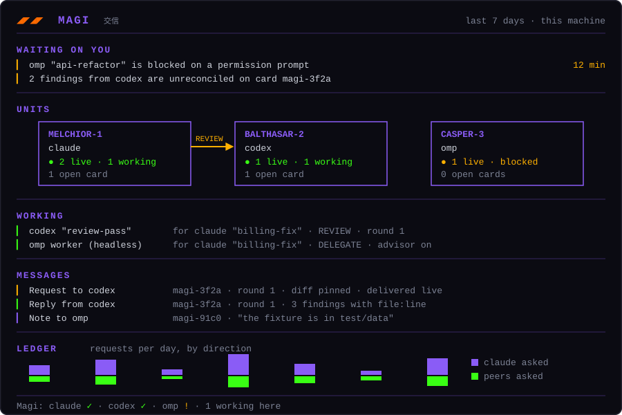

<div align="center">

# Magi

**Claude Code, Codex CLI and Oh My Pi, working as peers. Evidence over agreement.**

<a href="https://github.com/howeasy/Magi/actions/workflows/test.yml"></a>
<a href="LICENSE"></a>


<br><br>



<sub>Three agents, one verdict, and a rule about what counts as proof.</sub>

</div>

## What it does

You already run more than one coding agent. Magi lets them check each other's work.

Not "one model asks another for the answer." Two engineers who review each other, argue when they disagree, and settle it with something you can verify. A second model agreeing with the first proves nothing, so Magi is built around one rule:

```
EVIDENCE  >  REASONING  >  MODEL AGREEMENT
```

You do not call a tool. You ask in plain words, and the agent decides when a second opinion is worth it:

> Ask Codex to independently review this implementation.

> Have Claude fact-check these claims before answering.

> Use Codex as an adversarial reviewer of this architecture.

> Delegate the test implementation to Codex, then review its changes.

Each harness loads one Magi MCP server. A request goes to a session that is already running in the right directory, so the peer keeps its own context. If nobody is home, Magi starts a restricted headless process instead. Every exchange is written to a ledger under `~/.magi`.

## A consultation, start to finish



Here is one illustrative run, as it looks from your chair.

1. You tell Claude: "Have Codex review this before I merge it."
2. Claude sends Codex a `REVIEW` pinned to `HEAD~1..HEAD`, asks for `file:line` evidence, and keeps its own opinion out of the message.
3. Codex reads the diff in its own session and replies with four findings.
4. Claude opens the files and checks each one. Three hold. One is wrong, because the guard it says is missing sits two lines above the cited line.
5. Claude records the outcome (3 accepted, 1 rejected, 0 open) and tells you what it changed and why it dismissed the fourth.

Skip step 4 and Magi nags you: unreconciled cards are named on later calls, and more than three in one coordinator session hold new cards. `magi log` shows over time how often each peer's findings actually held up.

## The rules

| Rule | What happens |
|---|---|
| Independent first pass | The peer reviews without seeing your conclusions, so its agreement means something. |
| Pinned artifacts | A review records the diff hash and a repository snapshot, so you can tell after an edit whether the peer saw the current code. A hash records bytes, not proof anyone read them. |
| One orchestrator per task | Whoever you asked is in charge. The peer answers and stops, and cannot start its own request and loop. Roles reset per task, so both directions work ([recursion.md](docs/recursion.md)). |
| Reconcile, don't relay | The asking agent checks every finding against the source and reports what it changed, rejected and left open. |
| Bounded conversation | A peer can ask a question before it answers, and a debate can carry claims back for a rebuttal. Rounds are capped. |
| Read-only by default | Headless launches are restricted, and live reviews keep their session's permissions. Only a `DELEGATE` with `allowWrites: true` may write ([security.md](docs/security.md)). |
| No secrets in transit | Context carries only what the peer needs. Message text that `magi status` and the deck show is redacted and cut short. |

## Modes

| Mode | For | Waits for a live reply by default |
|---|---|---|
| `SECOND_OPINION` | uncertainty, sanity checks | yes |
| `REVIEW` | code and plans, after your own pass | yes |
| `ADVERSARIAL_REVIEW` | expensive or irreversible decisions | yes |
| `FACT_CHECK` | claims where being wrong costs something | yes |
| `DELEGATE` | a bounded subtask you will review | no |

Headless requests return after launch in every mode. Pass `wait: true` to block for the reply inline. `DEBATE`, `PARALLEL` and `BAKEOFF` exist in the engine but are not in the MCP tool schema.

### Options on a request

| Option | What it does |
|---|---|
| `diffRef` | Pins the review to a git diff: `HEAD~1..HEAD`, `--staged` or `worktree`. |
| `evidenceRequirements` | Tells the peer what proof you want, for example "cite file:line for every finding". |
| `allowWrites` | Lets a `DELEGATE` edit files. Without it, the worker changes nothing and says so. |
| `persist` | Names a long-lived peer that resumes its own context on every request, so it remembers the project. |
| `advisor` | On a headless omp worker, runs omp's advisor beside it. A second model reads each turn and steers only on a concrete problem. It costs a model call per turn, so it suits long runs ([usage.md](docs/usage.md#having-omps-advisor-watch-a-delegated-worker)). |
| `delivery` | `auto` routes around a peer blocked on a permission prompt. `live` sends anyway, with a warning. |
| `host` | Sends the request to a machine listed in `remotes.json`: a headless worker there, or with `peer`, a live session ([usage.md](docs/usage.md)). |

## Three harnesses, every direction

Any of the three can consult the other two, and omp can consult a distinct omp session. Anything else that loads MCP servers can join: serve it under its own name (`magi serve ... --as <name>`) and a small shim inside its session lets it be answered. Oh My Pi ships with both halves.

| Unit | Harness | Reaches the others through |
|---|---|---|
| MELCHIOR-1 | Claude Code | `codex_peer`, `omp_peer` |
| BALTHASAR-2 | Codex CLI | `claude_peer`, `omp_peer` |
| CASPER-3 | Oh My Pi | `claude_peer`, `codex_peer`, `omp_peer` |

## Watch it work



<sub>The /magi deck, drawn with sample data.</sub>

`magi install` adds a Claude Code mod, `magi-view`. Peer messages show as a plain header (`Reply from omp · magi-… · round 2`) over their body, without the protocol text, and your own Magi calls collapse to one line each with their delivery state. The model still reads every message as delivered.

The `/magi` deck shows what waits on you, the three units with the cards in flight between them, every agent working on a card, the last messages, a seven-day ledger and the provider switches. A band above the prompt appears only when a delivery fails, and the status line reads `Magi: claude ✓ · codex – · omp ✓ · 1 working here`. Details are in [install.md](docs/install.md#readable-peer-traffic-in-claude-code-the-magi-view-mod).

No mod? The terminal covers the same ground:

| Command | Shows |
|---|---|
| `magi status` | the three units, open cards, unreconciled replies, a seven-day ledger |
| `magi peers` | who is reachable: working, idle or blocked, and how full each context is |
| `magi log` | every task: mode, who asked whom, how the round ended, and the reconciliation outcome |
| `magi exchange <task>` | the words of one task: request, reply, outcome |
| `magi mail` | retained replies |
| `magi spawn <harness> --name <n>` | starts a named live session that peers can address |
| `magi doctor` | checks CLIs, auth, registrations and skills |

## Memory that all three share

`remember`, `recall` and `forget` keep notes in SQLite, one bank per repository (worktrees share it). Requests can carry relevant recalled evidence, and anything already delivered is not repeated. `magi memory export` writes the bank as markdown.

## Get started

You need Node.js 22.13 or newer (for built-in `node:sqlite`), git, and Claude Code and Codex CLI installed and signed in. Oh My Pi is optional and is wired in when Magi finds it.

```bash
git clone https://github.com/howeasy/Magi.git
cd Magi
npm install
node bin/magi.mjs install        # add --omp to set up Oh My Pi explicitly
```

1. Set `"crossSessionInbound": "accept"` in Claude's `settings.json`. The installer does not write it.
2. Restart every Claude Code, Codex and omp session. Each harness reads its MCP servers at startup.
3. Run `node bin/magi.mjs doctor` until it shows no `FAIL` row.
4. Open a session in a project that has a live peer and ask for a review.

The steps, with what each one checks, are in [install.md](docs/install.md), including the [omp setup](docs/install.md#a-third-harness-oh-my-pi-omp). More prompts and what each one triggers are in [usage.md](docs/usage.md). To remove everything, see [uninstall.md](docs/uninstall.md).

## Documentation

| | |
|---|---|
| [architecture.md](docs/architecture.md) | how it works, state layout, and prior art |
| [install.md](docs/install.md) | requirements, install and verify, upgrading, the Claude Code mod |
| [mcp-config.md](docs/mcp-config.md) | the MCP entries and the load-bearing settings |
| [usage.md](docs/usage.md) | what each prompt triggers, and the CLI |
| [security.md](docs/security.md) | permissions, sandboxing, redaction, bounds |
| [recursion.md](docs/recursion.md) | the anti-recursion model |
| [troubleshooting.md](docs/troubleshooting.md) | symptoms, their checks and fixes, error codes |
| [parity.md](docs/parity.md) | what matches Claude cross-session messaging, and what does not |
| [interop.md](docs/interop.md) | why not A2A, and when to revisit |
| [transport-recon.md](docs/transport-recon.md) | the delivery contracts, and how to repair them if they break |
| [mcp-caller-verification.md](docs/mcp-caller-verification.md) | how the bridge identifies the calling session |
| [agent-doc-evals.md](docs/agent-doc-evals.md) | how the skills and prompts are tested against a fresh agent |
| [brand.md](docs/brand.md) | the MAGI visual identity, as a design record |
| [docs/evidence/](docs/evidence) | captured evidence for the private formats Magi depends on, true for the versions each file names |
| [uninstall.md](docs/uninstall.md) | removal |

## Development

```bash
npm test              # offline: fake CLIs, an isolated state home per test, no model calls
PEER_E2E=1 npm test   # adds real Claude and Codex calls
```

Conventions, what is live and when, and where each kind of change belongs are in [AGENTS.md](AGENTS.md). Private formats (the Claude inbox frame, the Codex desktop steer channel, the omp extension API) are pinned to the versions they were checked against, and [transport-recon.md](docs/transport-recon.md) is the repair guide when one breaks.

## Licence and credits

Magi is [MIT licensed](LICENSE). The Claude Code mod's clock, pulse and layout follow [Flightdeck](https://github.com/scasella/claude-flightdeck) (MIT); see [NOTICE](NOTICE). [Prior art](docs/architecture.md#prior-art) lists the other projects whose ideas Magi took. The MAGI look is a nod to the display in *Neon Genesis Evangelion*.

<sub>Claude, Codex and Oh My Pi are products of their respective owners. Evangelion and MAGI are trademarks of their owners. This is an unaffiliated tool.</sub>
