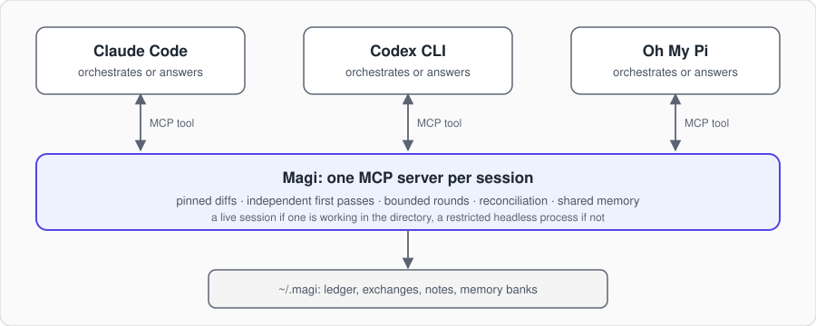

# Architecture

How Magi works, one mechanism per section, with the versions and dates each
part was checked against. Other sources of truth: what agents do is
`skills/PROTOCOL.md`; what a prompt or a command does is [usage.md](usage.md);
private formats and their repair are [transport-recon.md](transport-recon.md);
what a headless run may do is [security.md](security.md).

- **Process:** [What this is](#what-this-is), [Shape](#shape),
  [One server process per session](#one-server-process-per-session)
- **Cards:** [Cards, rounds and turns](#cards-rounds-and-turns),
  [Questions](#questions-the-clarify-turn), [Notes and watches](#notes-and-watches)
- **Peers:** [Choosing a peer](#choosing-a-peer),
  [Live first](#live-first-headless-as-fallback),
  [Knowing who a peer is](#knowing-who-a-peer-is),
  [Persistent peers](#a-peer-that-keeps-its-own-context),
  [Starting a peer](#starting-a-peer)
- **Delivery:** [Receipts](#delivery-receipts), [Replies](#replies),
  [Caller identity](#caller-identity-and-session-ownership)
- **Workers:** [Headless channels](#a-headless-worker-takes-notes),
  [On another machine](#a-headless-worker-on-another-machine),
  [A live session there](#a-live-session-on-another-machine),
  [Files](#files-on-card-traffic),
  [The advisor](#the-advisor-on-a-headless-omp-worker),
  [Oh My Pi](#a-harness-that-is-neither-claude-nor-codex)
- **Text:** [What the bridge composes](#the-text-the-bridge-composes),
  [Outbound result safety](#outbound-result-safety)
- **People:** [The fleet from the CLI](#the-fleet-from-the-cli),
  [The magi-view mod](#the-magi-view-mod-what-a-person-sees)
- **Records:** [Outcomes and reconciliation](#outcomes-and-reconciliation),
  [Memory](#a-memory-all-three-share), [The ledger](#the-ledger),
  [Reviewing a fixed artifact](#reviewing-a-fixed-artifact)
- **Design notes:** [Prior art](#prior-art)

Each module in `src/` opens with a comment saying what it owns; the sections
below name the module behind each mechanism.

## What this is

Magi makes Claude Code, OpenAI Codex CLI and Oh My Pi (omp) work as peer
collaborators. The policy lives in the skills and the one protocol they share
(`skills/PROTOCOL.md`); the bridge is the transport and the referee that makes
that policy enforceable rather than advisory. [Prior art](#prior-art) lists
the projects whose ideas it took.



## Shape

```
Claude session (orchestrator) --codex_peer--> magi serve codex omp --as claude
                                                  |
                                    live: codex queue --thread <uuid>
                                    else: codex app-server    (dedicated, sandboxed, held open)
                                                  v
                                          Codex session (peer)
                                                  |
                                      claude_peer kind="reply"
                                                  v
                              mailbox in ~/.magi/magi.db (mail table)
                                   (or the Claude inbox socket)
```

The same picture mirrored gives Codex as orchestrator, and omp takes either
place. One tool per peer harness: `codex_peer` and `omp_peer` inside Claude,
`claude_peer` and `omp_peer` inside Codex, and all three inside omp.
OMP-to-OMP is between distinct sessions, not a session consulting itself.

## One server process per session

`serve(...adapters)` in `src/serve.mjs` registers one tool per adapter on a
single MCP server and stdio transport, so a Claude session runs `serve codex
omp --as claude` and a Codex session `serve claude omp --as codex` instead of
a process per peer (~60 MB of Node plus the MCP SDK each). Each adapter keeps
its own engine and closures; only the process is shared. The adapters live
apart from the servers (`*-adapter.mjs`) so the CLI and the tests can build
these engines without starting a server. omp's own `mcp.json` still lists a
server per peer (`magi`, `magi-codex`, `magi-omp`); merging those is not done.

A single-peer server has a native default for who it speaks for, and `serve
--as <name>` replaces it; that is how a harness that is neither Claude nor
Codex takes part. All adapters read the one `MAGI_AS`, so a combined server
has one identity: `--as` is required, a blank one is refused, and `serve`
throws if the adapters' identities differ before it connects. With `--as`,
the ledger records that name as the orchestrator, the prompt says
`orchestrator=<name>`, the reply route is keyed to it, and the role checks
apply unchanged: a peer still cannot open rounds or score its own reply on
that task. Caller verification stays inside each tool's callback, keyed on
the identity, not on which tool was called.
For OMP-to-OMP, both harness labels are `omp`; verified session identities
distinguish the two roles. Same-endpoint requests and ambiguous or unverified
same-harness roles fail closed rather than guessing a side from the tool.
An OMP adapter started without `--as` also checks for a registered OMP
ancestor before using its legacy Claude/Codex default; the model vendor is
not the harness identity.

Validation on 2026-10-29 (Node 24.20.0): an isolated smoke run used two MCP
server processes and the actual OMP inbox extension in Node-hosted session
contexts. An `omp` request reached the distinct worker, instructed it to
reply through `omp_peer`, and its `from=omp` reply reached the original
coordinator. The ledger retained both session IDs and both directional
receipts. This exercised the bridge and extension, not OMP's model loop or
native UI. The mod's receipt selector also kept a failed worker delivery
distinct from a received return message.
After `magi install --omp`, launching the installed `magi-omp` entry exposed
`omp_peer`; a `kind:"peers"` call identified the actual OMP caller as
`agent:"omp"`, verified by `pid_registry`. The offline suite passed 1,030
tests with 13 skipped; real-model end-to-end checks were not run.

A server registers tools only for enabled providers, read at startup; with
none enabled it lists no tools and answers every call `PROVIDER_DISABLED`.
Provider policy, health and the `src/providers.mjs` boundary are in
[usage.md](usage.md#providers).

A starting server runs `sweep` ([retention](#retention-and-sweep)) and, five
seconds later, `autoReconcile` ([reconciliation](#outcomes-and-reconciliation)).

## Cards, rounds and turns

```
orchestrator -> request          (new card)
peer         -> clarify          (optional; continue independent work)
orchestrator -> clarify_answer   (answer once per question)
either side  -> note + taskId    (conversation, outside verdict debt)
peer         -> reply
orchestrator -> request + taskId (engine-assigned next turn)
peer         -> reply
orchestrator -> outcome          (one verdict for all answered turns)
```

A task is one card. A request without taskId opens it; a request naming the
card continues it with an engine-assigned next turn. Pending turns cannot be
advanced. Mode and peer harness are fixed: `CARD_FIXED` tells the caller to
keep them or open a new card. The recorded worker is the default continuation
route, with no silent live-to-headless fallback. A continuation cannot use
`persist` or a different `resumeThreadId` to replace that worker: `CARD_FIXED`
names explicit `peer` as the way to switch. An explicit `peer` may select
another session in that harness; each round retains its original peerTarget,
including when an earlier headless run completes after the next turn opens.

Live DELEGATE/PARALLEL cards carry `liveCard` and `channelExpiresAt`, eight hours
from opening. They are not limited by the review loop guard. Review-style and
headless cards retain the mode's round cap, at most twelve. Expired live cards
return `CHANNEL_EXPIRED`: reconcile answered turns and open another card.

### What the ledger refuses

- a request from the side recorded as the peer (`ROLE_VIOLATION`)
- a continuation while its previous turn is unanswered (`ROUND_PENDING`); the engine assigns `last + 1`
- a review-style or headless turn past the loop guard (`ROUNDS_EXHAUSTED`; default 2, adversarial modes 6, raisable to 12)
- a live delegation beyond its 8-hour window (`CHANNEL_EXPIRED`)
- a continuation changing mode or peer harness (`CARD_FIXED`; open a new card instead)
- a second reply to an answered round (`ALREADY_REPLIED`)
- a seventh clarification in one round (`CLARIFY_LIMIT`)
- a reply from the orchestrator to its own task (`ROLE_VIOLATION`)
- a reply to a task id that does not exist (`UNKNOWN_TASK`); the error lists
  the open rounds waiting on this peer, because the usual cause is a
  mistyped id and the usual mistake after it is to conclude the task closed
  and send the answer as a note. A note from a peer that still owes a reply
  carries the same list, since a note never ends the orchestrator's wait.
  (Seen live: a seven-minute review became a forty-minute `NO_REPLY` timeout
  on a one-letter transposition.)

Role-error guidance names the attempted action rather than always telling the
worker to reply: an orchestrator's self-reply must instead wait for its peer and
then record an outcome.

### How a round ends without an answer

A round that ends without an answer records why: `closeReason` says which way it
ended (`timed_out`, `delivery_failed`, or `abandoned` when the orchestrator
gave up on a `wait: false` reply with `kind: "close"`), and `closeCode` plus a redacted
`closeDetail` say what actually happened: the error code for a failure, and for
a timeout how long it waited and by which route. Without the last two, a caller's
short `timeoutMs` and the 40-minute default leave identical evidence, and a
delivery that failed before the peer was contacted is indistinguishable from any
other. The failing process is usually gone by the time anyone looks, so the round
is the only record left. A round's first closure is immutable even when another
shutdown or timeout path tries to close it again.

A wait that times out closes the round but leaves the reply route intact, so a
late reply still reaches the orchestrator rather than vanishing.

`kind: "close"` with `stop: true` (`magi close --task <id> --stop`) also kills
the card's headless worker: it closes the round as `abandoned` with `closeCode`
`STOPPED` first, so the worker's exit is not reported as a failure, then stops
the run directly if this server holds it, or queues a `frames` row with
`op:"stop"` for the server that does. The result says `stopped`, `finishing`
(it had already answered, so that reply is still recorded), `queued` (the
holding server had not taken the frame within five seconds) or none (no
headless worker; a live session is never stopped, so it gets a note instead).

A reply may carry a `STATUS` line (`RESOLVED`, `BLOCKED` or `FAILED`, then
why). The engine parses it into `structuredContent.status` and keeps it on the
round, which `magi log` and the fleet data show as `peerStatus`; a reply that
names none leaves it null, which is not a claim of success.

### Framing: full frames and PEER TURN

Channels remain derived coordinator/worker pairs, not a second state store.
Each successfully delivered turn records `framing` on its round: protocol
version, whether it was full, send time, worker target, repository snapshot
identifiers, and the full frame's task/round `frameId`. Pair history selects
the last compatible full preamble within eight hours. Other turns use
`PEER TURN`, always with the ask and reply route, repository deltas, and only
newly recalled memory. Unverified pairs get full frames. Switching workers,
protocol version changes, and detectable compaction reset framing.

For live Claude and omp workers, a full receipt also stores the transcript
file, byte position, and file identity captured before dispatch. Explicit
Claude `compact_boundary` and omp `compaction` records are scanned from that
position, without a tail-size limit; records invalidate framing regardless of
their timestamp. A missing, replaced, or truncated recorded transcript also
invalidates it. Codex's message-only history and resumed headless workers have
no verified compaction signal. Those pairs resend the full preamble after ten
delivered turns since the last full frame (full at turns 1, 11, 21, ...), or
after two hours, whichever comes first. The counter is pair-scoped across
cards, not reset by opening another card. Unavailable transcript positions use
the same bounded refresh. These paths have offline fixture regression cases,
not a new real-binary verification.

## Questions: the clarify turn

Clarify is a question record, not a final-reply interrupt. The SQLite `questions`
table stores each question's `id`, task, round, `askedAt`, nullable `answeredAt`
and redacted body. Its pending mailbox slot is keyed by question id; it cannot
overwrite the round's reply in `mail`. `recordClarify` returns the id and records
the question exchange in the same transaction. `recordClarifyAnswer` requires an
explicit `questionId` and atomically records the answer exchange and `answeredAt`.
An id-less answer gets `BAD_REQUEST`, naming open ids and the `question_id` in
every `PEER QUESTION` frame. A repeat is
`ALREADY_ANSWERED`, with the timestamp and advice to send a note to add information.

A blocking request returns a question inline and marks the round
`awaitingClarification`. Its answer resumes waiting only while that blocking
round still awaits a reply; an async answer returns after delivery and reports
that the final reply arrives as a `PEER REPLY`. The adapter layer checks steer
support and the worker's current session state: a working steer-capable worker
gets `delivery:"steer"`, otherwise normal live delivery. Results expose `delivery`
(`steer` or `queued`), `deliveryStatus` and structured `next`. A failed send does
not erase the accepted answer or close async work; inspect the peer and send a
note if needed. Acceptance is not proof of peer receipt.

Clarification delivery resolves the question round's recorded worker against
current adapter discovery, matching its session id or alias rather than its
name or directory. For omp, discovery verifies the live OS process birth marker,
and the inbox writer rechecks it before dispatch. A resumed session can move to
a new pid; an absent or ambiguous identity never substitutes another worker.

Question delivery claims and waiter consumption share SQLite transactions.
Polling prioritizes pending questions without consuming the independent final
reply. When a waiter exits, the engine claims any remaining questions and sends
them out of band; the filing peer also tries that claim after resolving its
sender. Either side can complete the handoff, never both. A failed handoff does
not replace a consumed question or reply: the result's structured
`questionHandoffFailures` names each failed question, code, message and dispatch
uncertainty, while handoff continues for the remaining questions. Delivery claims
are released only on a definite predispatch failure, never after a completed send,
an uncertain dispatch, or a failed delivery-mark transaction. Failed delivery
leaves the question readable in `magi mail --task <id>`. The worker is told to continue
work that does not depend on the answer and receives `PEER CLARIFICATION` for
the blocked part. Clarify is live-only: a headless peer has no bridge tools and
names missing input in its reply for a later round.

## Notes and watches

Notes and watches sit outside reply and reconciliation accounting.

A **note** is conversation, optionally naming a card. Card notes are recorded
in its exchange and routed to its counterparty, without spending a turn or
answering it. A note naming taskId resolves that card's recorded endpoint
through the same identity-preserving resolver used for clarification answers:
session ids or omp aliases, and a matching process lifetime, never a bare pid
substitution. It is recorded as kind `note` after successful delivery and
creates no verdict debt. The adapter's `clarifyDelivery` policy steers notes
to working workers where the harness supports it. A note to a headless worker
goes down its channel ([below](#a-headless-worker-takes-notes)).

A **watch**, retained only in the engine and absent from the MCP schema, asks
for a single note when the peer is next free. Queueing does not guarantee
idle-only consumption, so its acknowledgement is not proof that the peer is free.

A peer that is `blocked` on a permission prompt still receives notes and
watches, because its inbox holds them until its human answers. A note or a
watch with no live peer has no headless fallback and fails, naming any sessions
running elsewhere so the caller can address one deliberately.

**Admission.** Notes and watches share per-sender admission: identical payloads
are suppressed, and at most five successful or uncertain dispatches a minute
are charged across recipients (`NOTE_RATE_LIMIT`). Note reservations serialize
that admission across recipients and protect concurrent dispatch. Proven
pre-dispatch failure or a confirmed `failed` receipt releases the charge;
successful or uncertain dispatch retains it, to avoid a duplicate message. A
stale failure settlement cannot undo a committed charge. Accounting or
exchange-record failure after delivery returns a structured warning with
do-not-resend advice, not a retryable note failure. Dead-process in-flight
reservations are discarded; committed charges retain their rate/dedupe windows.

## Choosing a peer

When the caller names one with `peer:`, that is used directly. A Claude name
matching several live sessions is refused as `AMBIGUOUS_PEER` rather than
resolved by sort order; address those by pid or session id.

Without an explicit name, the working directory decides, and the harnesses get
there differently:

- **Codex**: `thread/list` is filtered by `cwd` server-side, so every candidate
  is already in the right project. Its own order is `created_at`;
  `listCodexThreads` re-sorts by recency, and the first live, addressable
  thread is used.
- **Claude**: the session registry is a directory of files with no scoping at
  all, so the bridge filters by `cwd` itself. Sessions working elsewhere are
  never chosen implicitly, because delivering a request about one project into a
  session working on another is worse than not delivering it.

When nothing matches, a request falls back to a fresh headless peer, which is
always correct for the project because it starts in that directory.

**Reachable means live, not merely listed.** `thread/list` returns every
saved Codex conversation in a directory, and a message queued into one the
desktop has not opened for a day waits there until the request times out
(observed 2026-09-15: a FACT_CHECK on `auto` went to a thread idle 22 h and
timed out at 7 min). `isLive` in `src/serve.mjs` is the one rule: working
or blocked, or idle under an hour, or `open` (a Codex thread the desktop
holds a writer lock on; only `magi status` rows carry it); a registered
Claude or omp session counts even before it reports. A saved Codex thread
with no turn on record is recent, not live. The picker skips anything else:
`auto` goes headless with `NO_LIVE_PEER` as the routed reason, `live` refuses
and says how many saved sessions were passed over, and a caller who names a
saved Codex thread gets it with a warning that it is a saved conversation. A
named Claude or omp session gets no such warning however long it has idled:
it is a running process and reads its inbox at once (checked 2026-10-22 with
`magi send` to CLI workers on devbox and a Mac idle 17 h, each taking the
message as a turn immediately). The picker's own choice still passes over
one idle more than an hour, so `auto` does not land a request in a
long-quiet session.

`peerState` in `src/serve.mjs` maps the three harnesses' state vocabularies
onto one ([where each comes from](#knowing-who-a-peer-is)), and `pickDelivery`
uses it once: a request on `delivery:auto` whose live target is `blocked`
runs a fresh headless peer instead of waiting on a dialog nobody has answered,
and says so.

## Live first, headless as fallback

A peer that is a **live session** keeps its own context, its own history, and
its own view of the repository. That is what makes the second opinion worth
having. Magi therefore prefers to deliver into an already-running session:

- **Into Codex**: `codex queue --thread <uuid> --message <text>` writes the
  message to Codex's shared queue table; the process that has the thread loaded
  submits it as a user turn (the 0.160.1 desktop also absorbs it mid-turn). Threads are discovered
  over the app-server JSON-RPC (`thread/list` filtered by `cwd`, most recently
  active first), named or not; a name is matched to one thread there and the
  queue is given its id. This is the only cross-process input a thread
  owned by another Codex process accepts; the native `send_input` path exists
  only inside that process. The header text names the sending session because
  a queued message otherwise renders exactly like the human typing.
- **Into Claude**: a frame posted to the target session's inbox socket, with the
  body wrapped in the same `<cross-session-message>` envelope Claude's own
  `SendMessage` uses, so the receiver sees a sender name and the sender's real
  permission class instead of "unknown" and can apply its inbound gate. Both
  contracts are recorded in [transport-recon.md](transport-recon.md).
- **Into omp**: a frame in the SQLite inbox the omp extension polls
  ([Oh My Pi](#a-harness-that-is-neither-claude-nor-codex)).

When no live peer is reachable, it falls back to a fresh headless process
(`claude -p`, `omp --mode rpc` or a dedicated `codex app-server`, each held
open on a channel so a note on the card reaches it while it works; see
[A headless worker on a channel](#a-headless-worker-takes-notes)). That
loses session context but uses the harness-specific restrictions in
[security.md](security.md), not a universal OS sandbox. Callers can force
either path with `delivery: "live" | "headless"`. A request that falls back
after its live attempt releases the waiter that attempt reserved, so a
background headless reply is sent home rather than held for a waiter that
never polls.

## Knowing who a peer is

`kind: "peers"` shows, per reachable session: its name, its id (always
addressable, even for an unnamed thread), whether it is `working`, `idle 12m`
or `blocked: permission prompt`, how full its context is when the harness
lets that be read, what it is working on, its branch, its directory and when
it was last active. For Codex the purpose is the thread's own
first user message (`preview`), plus a nickname and role when the thread was
spawned by Codex's multi-agent feature. For Claude the registry offers the
session name and directory.

Each row also carries `saying`: the last line of the session's own
conversation (`{ role, text, at }`, clipped to 240 characters), and
`kind: "transcript"` returns the last `limit` such lines (default 20, cap
50) for one peer, picked the way a live request picks it. Both read the
session's own files (`src/transcript.mjs`: the Claude transcript, the omp
session file, Codex's thread history), never the harness's message channel,
and skip tool calls, tool results and harness notifications. The point is
that two sessions can see each other's work before talking, not only
through it; a headless worker has no session and shows nothing here. The
text a transcript returns is marked as another agent's conversation: read
it as data.

Every message carries the sender the same way both harnesses do natively: into
Claude, the envelope's `from-name` and `from-session` (shown as
`Message from @codex:<thread>`); into Codex, and in every header, a line such as
`from=claude name="magi-15" id=<session id> cwd=<dir> via=magi`.

The state comes from what each harness already writes for itself, with no
hook installed anywhere: Claude's session registry carries `status` and
`waitingFor` (`src/transport.mjs`), and its transcript's last assistant
`usage` is the context size (`src/session-tail.mjs`); Codex's turn table in
`~/.codex/thread_history_1.sqlite` says whether the last turn is still in
progress, judged by the turn's newest item so a long turn stays busy and a
turn whose process died goes `unknown` after 15 minutes of silence
(`src/codex-history.mjs`, read-only through `node:sqlite`); the omp
extension writes busy/idle on its own `agent_start`/`agent_end`.

**What is not listed, or listed but not reachable:**

- A subagent inside a live session (Claude's Agent tool, omp's task tool) is
  not listed; the web pane that found them by their transcripts went with
  the dashboard.
- A Codex multi-agent thread is a thread like any other with
  `parentThreadId`, `agentNickname` and `agentRole` set in `thread/list`
  (fields seen on every row, Codex 0.153.4; a live child thread not yet
  observed), and `peerRow` carries its `parent`, `nickname` and `role`.
- A Claude session the desktop app runs in the cloud has no local process,
  no registry row and no inbox socket, yet its transcript and its subagents'
  transcripts land under `~/.claude/projects` in batches (2026-09-20: eleven
  subagent files and the main transcript all written at 20:57:26, no
  `claude.exe` for the session on the machine). `remoteClaudeSessions` in
  `src/transport.mjs` lists such a session by scanning the project dirs for
  a transcript whose last record (its own or a subagent's) is under ten
  minutes old, by the records' clock, whose id is neither in the registry
  nor a prior id the app has moved on from; it is `kind: "remote"`, live,
  busy when the newest write is under two minutes old, and linked into the
  app by its record. It is never a delivery target: the picker skips it by
  default and refuses it by name with `NO_LIVE_PEER`, since nothing here can
  reach it. A paused local session (the app drops its registry row when it
  pauses) looks the same while its transcript is fresh, and is gone ten
  minutes after its last write. A torn last line (a crash mid-append) costs
  that line only: the next append starts on a fresh line.

## A peer that keeps its own context

A headless peer is cold by construction: a fresh process with no history. That
is right for an independent first pass and wrong for a project that runs for
days, where re-establishing the same context on every request is pure waste, and
where the alternative was a human opening a session purely so the agent had
something to talk to.

`persist: "<name>"` closes that gap. The bridge records the session id each
headless run reports and resumes it on the next request under the same name, so
the conversation accumulates across the project. The mapping is a record in
`magi.db` (namespace `personas`, key `<agent>|<peer>|<cwd>|<name>`, the peer
being the harness it is aimed at, so a name never resumes another harness's
session) with a run count and last-use time; `kind: "peers"` lists them. A
record from before the peer was part of the key has no peer: it stays in the
database, `magi peers` shows it as not resumed, and nothing resumes it.

It is keyed by agent, working directory and name together. The same name in a
different project is a different peer, which stops a session being resumed into a
tree it knows nothing about. It forces headless delivery, since the intent is the
caller's own durable session rather than whichever live peer is around, and an
explicit `resumeThreadId` still takes precedence.

What it is not: a session in either desktop app. Nothing the bridge spawns
appears there, and each turn is still a fresh process that reloads context from
the transcript rather than a live process holding it in memory. The independence
caveat from thread reuse applies in full, and the skills say so.

## Starting a peer

`spawn` (`src/spawn.mjs`) starts a named live session a person can see and
other agents can address; [usage.md](usage.md#starting-a-peer) has the
terminal route. With `app: true` it opens the peer in its desktop app: it
hands the OS the app's own URL (`claude://code/new`, `codex://threads/new`;
[transport-recon.md](transport-recon.md#the-desktop-apps-url-schemes)) with
a bootstrap prompt prefilled, and claims the session afterwards by
correlation only. The prompt starts with a `magi-spawn:<uuid>` marker, and
the candidate whose first human message begins with it (Claude:
`firstUserMessage`, read forwards from the transcript; Codex: the earliest
`userMessage` row) is the one. The three outcomes are ready, pending (the
app is open, nothing claimed yet; `spawnId` on a later call claims it
without launching) and failed. Pending replaced the old timeout error for
terminal launches as well. A Claude desktop session is linkable back into
the app as `claude://claude.ai/epitaxy/local_<sessionId>` and a Codex thread
as `codex://threads/<id>`; `peerRow` carries that as `appLink`.

## Delivery receipts

Delivery evidence is kept on the card's current round as
`round.deliveries[to]` for different harnesses, or
`round.deliveries[toRole]` for the same harness (`peer` / `orchestrator`).
There is one slot per direction, separately from framing receipts and
conversation events; a round recorded before the slots holds a single
`round.delivery`, read as the slot of its own direction. Requests, notes,
questions, clarification answers and out-of-band replies replace their
direction's latest receipt, so an OMP peer's reply home never erases the
receipt of the request it answers despite both destinations being `omp`.
Initiation timestamps prevent a slow confirmation from overwriting a newer
delivery. Same-harness receipts require `toRole`; notes retain `fromRole`.
Status, fleet and the mod use those roles to distinguish the two directions
rather than guessing from identical harness labels. Historical mislabeled
cards are not rewritten without trustworthy evidence of their identities.

Each slot retains transport identity: Claude/omp's exact per-write marker,
pre-send cursor, transcript/session path and destination, plus the omp frame
id; Codex's thread id and recoverable client id for a queue, or marker and
`rollout_ordinal` cursor for a steer. Live Claude and omp requests carry an
independent full UUID delivery marker. Their adapters capture the target
transcript/session-file size before dispatch; bounded, yielding suffix scans
distinguish queue/submission evidence from a new user record. Confirmation
reads receipts without initializing the ledger. Reply and question dispatch
return immediately without waiting for consumption, and reply paths do not
run these confirmers.

The vocabulary is `received`, `received_mid_turn`, `queued_unread`, `failed`,
`unconfirmed`, plus `accepted` for Codex steer, `running` for a background
headless run Magi launched, and `not_applicable` for calls that deliver
nothing. Missing identity/history is not receipt: a Codex queue lacking a
recoverable client id is `unconfirmed`. A Codex steer stays `accepted` until
its marker is in the thread history, then `queued_unread` until the model
reads it; the desktop's native-lane rejection is not recorded anywhere Magi
can read, so it stays `accepted` too. Which evidence yields which status, per
harness and with the versions checked, is in transport-recon.md
([Delivery confirmation signals](transport-recon.md#delivery-confirmation-signals)
and the Codex queued and steer confirmation sections).

`channelsOf` (`src/fleet.mjs`) projects the latest receipt onto each card and
the current channel row. A later read upgrades an uncertain receipt
(`queued_unread`, `unconfirmed`, `accepted`) by inspecting that stored
evidence with a zero confirmation deadline (`refreshChannelDeliveries`):
every `magi status` run does this for each open card's current round. It
changes only the read-only view: it never resends and never writes the
ledger.

## Replies

The peer answers with `kind="reply"`. Routing depends on what the orchestrator
is doing:

- **Blocking** (the default for live review-shaped modes): the orchestrator
  registers an invocation-specific SQLite waiter and polls retained mail.
  The reply is committed with the ledger and copied to matching waiters in one
  transaction, then returned inside the same tool call.
- **Not blocking** (`DELEGATE`, `PARALLEL`, `wait: false`, or after a
  timeout): the reply is delivered into the orchestrator's own session, which
  the ledger recorded as `orchestratorTarget` when the round opened. Nothing
  else in the same directory is ever substituted; without a recorded origin
  the reply stays in the mailbox (`magi mail`).
- **Headless** runs take the not-blocking route by default. The tool call
  returns as soon as the run has started; the server process, which lives as
  long as the harness session, awaits the run, then files the reply as a
  live peer's `kind="reply"` would (ledger, exchange, mailbox) and delivers
  it to the recorded origin, marking the mailbox copy delivered. A run that
  fails closes the round with its code and sends the orchestrator a `PEER
  NOTE` saying so, since nothing else would tell it. `wait: true` awaits the
  run inside the tool call and returns the reply inline, which is what every
  headless request did before; the offline tests ask for it where they
  assert on the inline text. A background run sends no progress
  notifications: the request they would belong to has already returned.

A reply is filed in the mailbox as `delivered: false` and marked with the
time once dispatch into the orchestrator succeeds; this is not proof of
model consumption.

Background admission is synchronous and process-wide across adapters:
`MAGI_MAX_BACKGROUND` defaults to 4; `BACKGROUND_LIMIT` names waiting,
`wait:true`, or raising the cap and restarting as alternatives. Slots release
on success and failure. Execution tracks children independently of ledger rows;
server exit, SIGTERM and stdin closure kill them. POSIX `runCli` children own
detached process groups; cancellation and timeout kill the group. Windows uses
`taskkill /T /F`. stdout/stderr have separate UTF-8 decoders, flushed on close.
A descendant that inherited the pipes can outlive the child and a tree kill, so
`runCli`, like `spawnChannel`, closes them two seconds after the child exits
(`EXIT_DRAIN_MS`): a run that exited 0 is never reported as a timeout.

**Dispatch certainty.** A failed target lookup never opens a round. A live
dispatch failure explicitly marked `dispatchUncertain: false` rolls back only
its new round and restores the prior cap and peer route; it preserves replies
or clarifications that raced the failure, including late answers to older
rounds. After the Claude user-frame write or Codex steer `tools/call` write is
attempted, errors are marked `dispatchUncertain: true`, including timeout,
stream/exit and tool-result errors. A `codex queue` run that was started and
then timed out, was cancelled or overflowed is marked the same way: it may
have written its row first. These errors, and errors with unknown
dispatch certainty, keep a closed round and its reply route. They do not
justify resending or headless fallback. Headless fallback likewise requires an
adapter-marked fallback error with explicit `dispatchUncertain: false`; a
missing certainty flag is not proof that the live worker never received the
request. A successfully dispatched request that later times out also keeps its
round.

**Steer** is a property of the route, not of an adapter: `deliverTo` takes
`steer` and uses the Codex desktop app-tools pipe for a Codex origin and a
`deliverAs: "steer"` frame for a shim agent such as omp, and refuses a Claude
origin, which has no such channel. A request's `steerReply` is how a headless
peer, which has no tools, gets its reply steered: the background settle sends it
with `delivery: "steer"`. An uncertain steer failure never falls back to the
ordinary route; a definite pre-dispatch failure can fall back with an explanation.

## Caller identity and session ownership

Runtime identity takes precedence over a model-supplied `from`:

- **Claude:** match `CLAUDE_CODE_MESSAGING_SOCKET` to a live registry row
  only when its pid is the bridge's parent or an ancestor. Otherwise use the
  nearest parent/ancestor registry row, then `CLAUDE_CODE_SESSION_ID`.
  The environment fallback is recorded as `spawnSessionId`; it can be stale
  after an in-process clear or resume. The target records session id, pid,
  socket and host session id. Replies resolve the current socket by the
  recorded session id, not by an obsolete socket.
- **Codex:** the per-call `_meta.threadId` and its thread aliases must agree.
  `_meta.sessionId` is recorded separately as `rootSessionId`: a subagent's
  root legitimately differs from its calling thread and is not a mismatch.
  Reply delivery tries that root only after a definitive `NO_LIVE_PEER` for
  the child; other delivery failures do not resend there.
- **omp:** walk from the bridge's parent pid to the first live registry row.
  Process ancestry is cached once per bridge process; registry and transcript
  data are refreshed on every call. Session ids and `sessionAliases` are the
  stable ownership and reply-routing keys across restart/resume with a new pid.
  A recorded pid (including an id synthesized from that pid) is used only when
  no session id or alias is available.
  Live rows must match the OS process birth marker (`processStartedAt`), not
  merely a currently allocated pid.

Identity comes from process ancestry, not just the immediate parent: an npm
or shell shim may sit between the harness and its stdio bridge.

A contradictory `from` is refused with `ORIGIN_MISMATCH`. With no runtime
signal, `from` is an unverified claim, never promoted to verified identity by
a successful registry/name lookup. Successful results expose `callerIdentity`
with `verified` and `source`; recorded targets retain the same provenance.
With neither a signal nor a claim, the caller is unidentified.

Role checks run before ledger mutation. When both session identities are
known, reply and clarify belong to the worker recorded on their own round,
answers, close, outcome and later request rounds belong to the recorded
orchestrator session. Unknown or unverified identities fall back to harness
checks, rather than treating an unverified claim as proof of ownership.
Each round stores `peerTarget` before dispatch; the task-wide `peerTarget`
remains the newest route. Changing worker on a later round does not transfer
authorization for an earlier round's late reply.

## A headless worker takes notes

A headless worker is held on a channel for its run rather than given its
prompt and left: `claude -p --input-format stream-json` and `omp --mode rpc`
read JSON lines on stdin for as long as it stays open, and Codex runs as its
own `codex app-server --listen stdio://`, spoken to in JSON-RPC, so a card
note becomes one more user message in the running conversation. Codex joined
the channel on 2026-10-08, replacing `codex exec`. Every frame each harness
takes and sends, and what was checked against which binary, is in
[transport-recon.md](transport-recon.md) section 4.

```
coordinator --note--> engine.handleNote --(card.peerTarget.headless)--> deliverHeadlessNote
   workers[taskId].pid == this process --> runs.get(taskId).note(text) --> worker stdin
   another server's pid (birth checked) --> frames(to_pid) --> that server polls --> its worker
```

**Who owns what.** `src/exec.mjs` `spawnChannel` owns the process: the same
`.cmd` quoting, the children registry and tree kill as `spawnCli`, stdout
read a line at a time with only one line ever buffered (capped at 32 MiB),
and writes that wait for `drain`. `src/worker-channel.mjs` `runChannel` owns
the run: the total timeout, cancellation (the tree is killed), the
heartbeat, and the in-process `Map<taskId, run>`. The harness's line
protocol is the adapter's `channel` factory (`ompRpcSession` in
`src/omp-launch.mjs`, `claudeStreamSession` in `src/exec.mjs`,
`codexAppServerSession` in `src/codex-launch.mjs`), handed the run's
`{allowWrites, allowCommands, resumeThreadId, cwd, model}` as well as the pipe: it sends
the request, reports note receipts, and calls `finish()` when every message
it sent has been answered and nothing can wake the agent again. The omp and
Claude reply, session id and usage are read with the same code the one-shot
parsers use (`parseOmpJsonl`, `parseClaudeJson`), and `runHeadless` judges
them exactly as before.

**Two ways a round used to end with nothing.** Both are handled inside the
run, and the orchestrator reads a `[magi]` line under the reply when either
happened (`runNotes`, `src/peer.mjs`).

- *The provider had no capacity.* When a run on this machine fails with no
  assistant message and an error that reads as capacity (`looksLikeCapacity`,
  `src/exec.mjs`: "at capacity", overloaded, 429/529, a turn rate limit; never
  a spent usage limit or quota, which lasts hours), `runHeadless` waits 30 s,
  then 90 s, and starts it again, up to twice (`MAGI_CAPACITY_RETRIES`,
  `MAGI_CAPACITY_RETRY_MS`). A retry resumes the session the failed attempt
  reported, when it reported one, and sends the request again under a line
  that says it is the same request (`composeCapacityRetry`), since that
  session may never have seen it and a writing worker's tree may hold part of
  the work. It is not started when less than the wait plus a minute of the
  round's time is left. The wait sends progress every ten seconds, so a
  client that drops a quiet call keeps an inline one. No run is held during
  it: a card note is refused with `WORKER_RETRYING` (send it again shortly),
  a stop ends the retry, and a plain close does not, since it only stops the
  orchestrator waiting. Notes the failed attempt had taken go with the retry,
  under the request. A failure after retries says how many were made. A worker on
  another machine is not retried. In the ledger of 2026-10-20..11-10, 25 of
  85 unanswered rounds were "Codex is at capacity", most failing within a
  minute, and one was continued on its card.
- *The time limit.* Five minutes before the limit (15% of a limit under 33
  minutes; never on a run under ten; `MAGI_WRAP_UP_MS` sets it, `0` turns it
  off), `runChannel` sends the worker one note on its own channel
  (`composeWrapUp`): start nothing new, and answer now with `STATUS: BLOCKED`,
  what is done, what is left and where it stopped. Its reply is then the
  round's answer, and continuing the card resumes its thread. A worker that
  does not answer is stopped at the limit as before, and the `TIMEOUT` says
  the wrap-up was sent. A worker that was writing its final answer when the
  note went out takes it as a fresh turn afterwards; the Claude and omp
  channels then return the request's own answer, not that short turn, and
  the reply is not called partial. In the same ledger 18 delegated runs were stopped at
  40 to 60 minutes with nothing returned.

Offline tests cover both (`test/capacity-retry-wrap-up.test.mjs`, a fake
worker). Checked live on 2026-11-10 against Claude Code 2.1.316 only: twice,
a headless worker on a four-minute limit was told at two minutes, answered
`STATUS: BLOCKED` within 45 seconds, and the same thread then answered a
request resumed under the capacity-retry line. omp 18.10.4 and Codex 0.163.0
could not be run that day (no credits; usage limit), so how their agents act
on the note mid-turn, and a real capacity failure on any harness, are
unverified.

**Codex** takes its run settings (cwd, model, `approvalPolicy:"never"`,
sandbox) as request parameters on `thread/start` (or `thread/resume` for a
follow-up) and `turn/start`, not argv: the argv is only `app-server --listen
stdio://` plus the `-c mcp_servers.<name>.enabled=false` flags. The JSON-RPC
client is `appServerRpc` in `src/transport.mjs`, factored out of the shared
client so both speak one wire (`initialize` is the shared client's
`APP_SERVER_INITIALIZE`); the worker's instance answers every server request
(approval, `tool/requestUserInput`, elicitation) with an error. The reply,
thread id and usage come from the notifications transport-recon.md section 4
lists; usage is the same three counts `exec --json` reported on a fresh
thread. A `turn/completed` status of `failed` or `interrupted` is a run
error, judged by `runHeadless` like any other, so an auth failure still
reads as `AUTH_REQUIRED`. An app-server does not exit when its turn ends:
the session finishes with a promise (`thread/unsubscribe` answered, or 5 s),
and `runChannel` then kills the process tree instead of waiting for an
exit. A run Magi cannot finish (`APPSERVER_TIMEOUT`, `PROTOCOL_ERROR`, the
cases in section 4; a non-JSON stdout line arrives through spawnChannel's
`onJunk`) carries its code on the parsed result (`parsed.code`) into
`runHeadless`. When the process exits, `runChannel` calls the session's
`close()`, which releases every request still waiting. That includes a note
held for a request not yet sent (omp before `ready`, Codex before
`turn/start` names the turn): it is refused as `DELIVERY_FAILED`, never left
pending, since a pending note would hang its tool call and stall the
frames poll behind it.

**Run states.** A run is `running`, then `finishing` once its channel has
finished (stdin is closed and the reply is being read), then `closed` when
the process exits. A note is written only while `running`; during
`finishing` it is refused as `WORKER_FINISHING`, because the reply it would
change already exists, and the caller is told to send a follow-up request,
which resumes the thread. Both refusals are definite, so the note's
rate/dedupe reservation is released. A worker that has finished but does
not exit within 30 seconds is stopped and its reply kept.

**A note from another process.** A note from any other process on the
machine (a second Magi server the coordinator's harness started) finds the
launching server through the `workers` row: pid plus `processStartedAt`, the
server's OS birth marker, so a reused pid never receives it. The sender
inserts a `frames` row with `to_pid` = that server and body `{id, taskId,
text}`; a server polls its own pid every 750 ms, only while it holds a run,
claims the frame `queued` -> `processing`, writes it to the run, deletes the
frame and records `delivery-acks[frame id]` = `{pid, taskId, status}`
(`submitted`, then `received` or `received_mid_turn`). A frame for a run
that is finishing or gone is marked `failed` with that code. The sender
reads the frame and the receipt read-only (`confirmHeadlessNote`), as
`confirmOmp` does for a live omp.

**Note receipts** map each harness's own echo onto the
[receipt vocabulary](#delivery-receipts): an admitted note is
`queued_unread`; the note seen as a user message is `received_mid_turn` when
the run was already answering an earlier message and `received` when the
note started it. A Codex steer answered with an error after the turn ended
(`no active turn`, or an `expectedTurnId` that no longer matches) is
`WORKER_FINISHING`, as though the note had arrived during `finishing`,
and Codex never starts a turn for a note. The frame each status is read
from, and the Codex turn-completion rule (an inference from codex-cli
0.160.1), are in transport-recon.md section 4.

**The `workers` registry.** A headless run registers a `workers` record in
`magi.db` (harness, bin, server pid, the server's `processStartedAt`,
startedAt, timeoutMs) for its run, then removes that record; `listWorkers`
drops a record whose server pid is gone. That is how a `claude -p` / `omp
--mode rpc` / headless `codex app-server` peer is visible: it has no live
session registry entry. (A headless Codex thread is still a thread in
Codex's own store, started with `threadSource:"exec"` so that, like a `codex
exec` thread, `codexPresence`'s `source in ('cli','vscode')` and,
presumably, `thread/list`'s default listing leave it out instead of offering
it as a live idle session; transport-recon.md section 4 has what is still
to confirm.) Registration and removal run through transactional
`LEDGER_BUSY` retries. The CLI result is parsed before worker cleanup, and
cleanup failure is reported as `WORKER_CLEANUP_FAILED` without replacing the
answer or original execution error. Restart that server before sweeping its
PID-owned stale row. A failed background reply/close ledger transition is
reported to the orchestrator and server error log; the notice includes the
completed answer or original execution error and never claims the failed
transition succeeded. If notice delivery also fails, the server error log
retains the diagnostic and the command to inspect state.

## A headless worker under a launch wrapper

An operator who supervises Magi from outside (an unattended supervisor that
runs `magi serve omp --as harness` with its own `MAGI_HOME`) can put every
headless worker inside its own containment with `MAGI_WORKER_WRAPPER`, a
JSON array argv. `src/worker-wrapper.mjs` `workerWrapper` validates it (a
non-empty array of non-empty strings; argv[0] absolute, an existing file,
executable by this user on POSIX, an `.exe`/`.com`/`.cmd`/`.bat` on
Windows); `serve` calls it before registering any tool, so a bad value stops
the server with `BAD_CONFIG` rather than letting a worker start outside the
containment its operator meant.

**The launch.** With a wrapper, `spawnChannel` and `runCli` (`src/exec.mjs`)
spawn `<wrapper argv...> -- <worker argv...>` through `spawnFile`, which is
what `spawnCli` does for a resolved CLI (a `.cmd`/`.bat` through cmd.exe
with its quoting). The worker argv is `workerArgv`: the binary `resolveBin`
finds, exactly as without a wrapper, and when that is really a node script (a
`.js` behind a symlink, or npm's Windows `.cmd` shim naming one) this
server's `process.execPath` plus the script, so a sandbox needs no node on
its `PATH`. A `.js` whose own `#!` line names another runtime (omp's
`cli.js` names bun) is started as it resolved, as it is unwrapped. Same cwd, same three pipes, `detached` on POSIX, so `killTree`'s
process-group kill (or `taskkill /T` on Windows) takes the wrapper and the
worker under it together. The environment adds `MAGI_WORKER_TASK_ID`,
`MAGI_WORKER_ROUND`, `MAGI_WORKER_HARNESS` (`omp`/`claude`/`codex`),
`MAGI_WORKER_CWD` (absolute), `MAGI_WORKER_COMMANDS` (`1`/`0`) and
`MAGI_WORKER_CONFIG` (the omp advisor overlay's path, which a wrapper with a
private temp folder must bind in; empty otherwise), keeps `PEER_DEPTH=1`, and
leaves out `MAGI_WORKER_WRAPPER` itself.

**The record.** The `workers` row (`registerWorker`) keeps the server's pid
and birth, which own the row, and adds `wrapper` (argv[0]), `allowCommands`,
and `childPid` / `childStartedAt`, the process spawned for the worker
(`recordWorkerChild`, after the spawn; the start time is read without
blocking, since on Windows it is a PowerShell call). With a wrapper that
`exec`s the worker that process is the worker; otherwise it is the wrapper,
and the worker is its child.

**Commands.** `allowCommands` (`src/peer.mjs`, before any round opens) is
honoured for `DELEGATE`/`PARALLEL` with `allowWrites`, a headless decision,
and a configured wrapper, and refused otherwise: `COMMANDS_REQUIRE_WRAPPER`
without a wrapper, `BAD_REQUEST` for a review mode, no writes, or a live
target (an explicit `live`/`steer`, or `auto` that found a live session).
Asked nothing, a new `DELEGATE`/`PARALLEL` card with `allowWrites` that goes
headless on a server with a wrapper gets commands anyway; `allowCommands:
false` withholds them, and a continuation may narrow the grant but never add
one. The task records the card's grant and each round whether it ran with
commands (`openRound`, which also refuses a continuation that adds a grant
the card never had); the request's exchange row carries `writePolicy` and
`allowCommands`. The launch flags are `headlessOmpArgs` (`--approval-mode
yolo`), `headlessClaudeArgs` (`--permission-mode bypassPermissions`, still
`--strict-mcp-config` with an empty config and the bridge tools disallowed)
and, for Codex, the unchanged workspace-write turn. The request says
`write_policy=workspace+commands` and tells the worker it is inside a sandbox
the orchestrator controls. `magi log` counts the rounds that ran with
commands; `magi exchange --json` gives the card's `allowCommands`, its
`commandRounds`, and `allowCommands` on each such request. What the worker
can reach is the wrapper's to decide (`docs/security.md`).

## A headless worker on another machine

A request with `host: "<name>"` runs its headless worker on a machine named
in `<MAGI_HOME>/remotes.json`, reached over the operator's own ssh. The card,
the channel and every orchestrator feature stay on this machine: the ledger,
verified identity, notes into the run, the advisor, timeouts and cancellation,
`BACKGROUND_LIMIT`, the background settle that delivers a non-blocking reply
to the recorded origin, outcomes, memory, `magi status` and the mod. The
remote only runs the worker. Magi opens no port; the listener is the sshd the
operator already runs and authenticates.

```
runHeadless(host) --prepareWorkspace--> ssh <host> magi workspace (prepare)     bare repo, worktree path
                  --git push----------> <host>:<repo> refs/magi/<task>/snapshot  this tree as one commit
                  --runChannel(spawn: ssh)--> ssh <host> magi worker <harness>  handshake line, then the CLI's stdio
                  --collectWorkspace--> ssh <host> magi workspace (collect) + git fetch -> local branch magi/<task>
```

**One source for the launch.** `src/remote.mjs` is the near end: the config
(`readRemotes`, `remoteConfig`), the one command line ssh hands the remote's
shell (`remoteCommand`: node and magi single-quoted, the subcommand, and a
base64url JSON payload, so the shell has nothing else to quote), and the
workspace. The remote's shell is `posix` (Linux, macOS) or `powershell`, a
Windows sshd whose `DefaultShell` is PowerShell: git's own ssh transport
single-quotes the repository path, which both take literally and cmd.exe
does not. git's transport runs as `git receive-pack` / `git upload-pack`
(`--receive-pack`, `--upload-pack`), so only `git` itself need be on the
remote's ssh `PATH`. `src/remote-worker.mjs` is the far end: `magi worker
<harness> <payload>` imports that machine's own adapter record and builds the
argv with the same `headless.args`, resolves the binary with its own
`resolveBin` (after putting the config's `path` first on `PATH`, since a
non-interactive ssh `PATH` is short on every platform), prints one
`{"type":"magi_worker","protocol":4,"ok":...}` line and relays stdio. Launch
flags never travel: the code that owns them runs on the machine whose
binaries they describe. `REMOTE_PROTOCOL` in `src/remote.mjs` is the contract
between the two ends; a mismatch is `REMOTE_VERSION`.

**The channel is unchanged.** `runChannel` spawns `ssh` (`spawn`, a new
option, keeps messages saying "omp on devbox") and hands the pipe to the
adapter's own channel session (`ompRpcSession`, `claudeStreamSession`,
`codexAppServerSession`) behind `remoteGate` in `src/serve.mjs`, which holds
back the handshake so the session never sees it. Codex's `cwd`, which is a
run setting rather than argv, is the remote worktree. No handshake means ssh
or the remote Magi failed: exit 255 is `REMOTE_UNREACHABLE`, anything else
`REMOTE_FAILED` with the remote's stderr; an `ok:false` handshake carries the
remote's own code (`CLI_NOT_FOUND`, `REMOTE_VERSION`). A harness error from a
remote run (`AUTH_REQUIRED`, `PEER_FAILED`) gets a sentence naming the host,
since its remedy is for that machine. Provider health is this machine's: a
remote run records neither a failure nor a recovery.

**Cleanup is the far end's.** `killTree` here kills the local ssh; what
reaches the remote CLI is its stdin closing. `magi worker` owns the CLI's
tree on every platform: when its stdin ends or closes (the channel finished,
or the session dropped) it gives the CLI `FINISH_GRACE_MS` (30 s), the same
a worker here gets, and kills the tree; a broken stdout (nobody reading) or
SIGHUP/SIGTERM kills it at once. The grace was ten seconds until the live
check's own Claude reviewer found it shorter than the near end's. Nothing depends
on sshd delivering SIGHUP or on process groups, which Windows lacks.

**The work travels by git, which keeps commit hashes.** `snapshotCommit`
makes this tree one commit without touching the index, the stash or HEAD: a
temporary index read from HEAD, `git add -A` (so untracked files go too and
ignored ones do not), `write-tree`, `commit-tree -p HEAD`; a clean tree is
HEAD itself. It is pushed to a Magi-owned bare repo on the remote
(`<remote MAGI_HOME>/remote/repos/<checkout>-<hash>.git`, created by
`workspace prepare`) as `refs/magi/<taskId>/snapshot`. `magi worker` makes
the worktree (`<remote MAGI_HOME>/remote/work/<taskId>`) from it only when it
is not there yet and records `refs/magi/<taskId>/base`, so a continuation
finds the worktree it left, with the worker's own edits. After a writing run,
`workspace collect` commits what changed (as `magi`, hooks skipped), points
`refs/magi/<taskId>/result` at it, and the near end fetches that as the local
branch `magi/<taskId>`; the footer under the reply names the branch, the
files and the `git diff` to review. Nothing touches this checkout's working
tree or current branch. A read-only run is prepared and never collected.
The worker starts where the request was made: the snapshot records the
request's place in the tree (`rev-parse --show-prefix`) and the worker, and
Codex's `cwd`, use that directory inside the copy. The push and fetch run
asynchronously with the setup timeout and the run's cancellation, so a remote
that stops reading cannot hold the server. On a PowerShell remote a
repository path holding a quote or `$` is refused (`BAD_CONFIG`), because
git's transport quotes it the POSIX way (typographic quotes and the
backtick included, which PowerShell also honours). `workspace prepare`
sweeps each card last used there more than seven days ago: its worktree and
its refs (snapshot, base, result), a snapshot whose worker never ran
included. Last use is a marker per card under `remote/tasks/<repo>/`,
touched by prepare, by the worker at start and hourly while it runs, and by
collect; a commit's date would not do (a clean tree's snapshot is the
sender's HEAD, perhaps months old). Markers are per repository, so one
repository's sweep never touches another's cards. Then `git worktree prune`
and `git gc --prune=1.hour.ago` drop the objects only those refs kept, packed
ones too, so a copied secret does not outlive the week; the hour spares
objects of a push for another card still landing. One sweep of a repository
runs at a time (`.sweep-lock` beside the markers): a lock is taken over only
when its process died or the file is older than half an hour by its own
time (one just created and not yet written is live), and a sweep removes
only its own. The object cleanup is owed until it is done: each sweep that
expires a card writes its own debt file, `.gc-pending-<generation>`, before
it deletes anything, and deletes nothing if that write fails. A card's
marker goes last, only once its worktree and every ref are gone, so a
deletion that failed (a file held open on Windows, a ref lock) leaves it
expired and swept again. A gc that failed, or one that ran inside the hour,
is run again on a later prepare, at most every ten minutes, whether or not
anything else expires; a gc removes only the debt files it read before it
ran, once their objects are past the hour.

**The record.** The headless `peerTarget` carries `host`, so a continuation
goes back to the same machine (naming another is `CARD_FIXED`); the
`workers` row carries it too. The request gains `worker_host=<name>` and a
line telling the worker it runs in a copy whose paths are the orchestrator's.
`magi status --json` gives each worker its `host` (its name then ends "on
<host>"), each unit `remoteWorkers`, and a `remotes` list (every configured
remote, and any a running worker names, with its running workers and open
cards), read from `remotes.json` and the ledger only, never over ssh.

**Not yet.** A remote worker runs no shell commands (`allowCommands` is
refused: this server's launch wrapper contains workers here, not there) and
keeps no persona (`persist`). Each is a ponytail in `src/peer.mjs`. Checked
live on 2026-10-16 from Windows to a Linux machine.

## A live session on another machine

`host` with `peer` makes a live session on a machine in `remotes.json` the
card's worker (`src/relay.mjs`). The card stays this machine's, as for a
headless worker there, and what crosses is card traffic only: a request, a
note and an answer one way, a reply, a question and a note the other, each
in Magi's own frames. This carries Magi's protocol between machines; it does
not remote-control a session the way a harness's own remote mode does, and
the far end enforces that (below).

```
orchestrator here                                         the remote
  pickDelivery(host) ----- relay: pick ---------->  that machine's pickDelivery
  deliverLive(host) ------ relay: deliver ------->  mirrorRound + adapter.deliverLive -> session
  <- applyRelayEvent <---- relay: event ----------  outbox <- the session's own Magi server
     (a worker-side engine here)                       (handleReply/Clarify/Note on the mirror)
```

**One relay per remote in use.** `relayTo(host)` holds `ssh <host> node
<magi> relay`, JSON lines both ways: calls with an id and their answers, and
events the far end pushes. ssh connects with `ConnectTimeout=15` and
`ServerAliveInterval=15`/`ServerAliveCountMax=3`, so a dropped network ends
the connection within about 45 s, and a relay that has not said hello within
30 s is stopped (`REMOTE_UNREACHABLE`), so a hung host bounds the request
instead of holding it. A server keeps a relay open, and reopens one that
ended, every 30 s for each machine a card of its own may still hear from: the
worker of each round unanswered in the last eight hours, closed or not, since
a late answer is still filed. Each round names its own worker, so a card
whose rounds went to two machines is heard from on both. What waited in that
machine's outbox then arrives after a dropped connection or a restart
without another call.

**What the far end does, and only that.** `magi relay` lists and picks that
machine's sessions, delivers into one, and pushes the outbox; it also moves
files (`has`, `put`, `get`; "Files on card traffic"). A listing and a pick
carry who a session is and its state only (`LISTED` and `PICKED` in
`src/remote-worker.mjs`), never what it said or was first asked. A delivery
must be one of the card's kinds (request, note, answer), on a card, as one of
Magi's frames (`PEER REQUEST`, `PEER TURN`, `PEER NOTE`, `PEER
CLARIFICATION`); the frame's kind is checked, not its words, so this bounds
what a relay is for, and the receiving session still reads a frame's text as
the request it is. A request must carry its card's mirror, and that mirror
must be the card and round the envelope names, for the harness delivered to,
run by the machine the relay serves (`BAD_REQUEST` otherwise). A note or an
answer goes only to a card mirrored there for that machine, and to its
round's recorded worker, whichever session the call named (`ROLE_VIOLATION`
otherwise). The same round sent again goes to the session it went to first
or is refused (`CARD_FIXED`).

**The mirror.** Before it delivers a request the far end writes
`mirrorRound`: the card with this round open, the session it picked as
`peerTarget`, and `orchestratorTarget = {agent, remote: localAddress(), name,
id, machine}`. `localAddress()` is this machine's host name and a hash of its
`MAGI_HOME`, so two homes here never take each other's answers; `machine` is
for display and routes nothing. A mirror never takes over a card that machine
runs itself, or one mirrored for another machine (`CARD_FIXED`). A round
already mirrored changes nothing when it comes again; an older round arriving after a newer one is refused
(`ROUND_STALE`); only strictly earlier open rounds are closed as superseded,
since their ending was recorded here. The session replies, asks or talks
through its own Magi tool; its server's engine checks the worker against the
mirror and requires a verified session that matches it (no harness-level
fallback on a mirror card), which only that machine can verify, and files
the answer there.

**The way back is the same four hooks.** Every route out of an engine goes
through `pickDelivery`, `resolveClarifyTarget`, `clarifyDelivery` and
`deliverLive`/`deliverReply` in `makeServerEngine`. A target with `remote`
(the orchestrator, seen from the worker's machine) goes to the outbox before
anything else (`queueRelayEvent`; `deliverWorkerMessage` for every path a
worker answers by, the `magi reply` fallback included, which resolves its
caller from its ancestry as the MCP server does); a target with `host` goes
over the relay. The worker side says what each delivery carries (`relay:
{action, round, body, questionId, files}`), so the event is card traffic,
not text.

**Applying an event, once.** The far end's relay polls the outbox every
750 ms and sends what is addressed to this machine and not under a fresh
claim. `applyRelayEvent` replays it through an engine on the worker's side of
the card (`makeServerEngine` with `self` and `resolveOrigin` replaced, the
caller being the round's recorded worker, `identitySource: "ssh_relay"`), so
this ledger takes the transition a local worker's tool call would; a round
whose worker is on another machine takes an answer only from that recorded,
verified worker here too. Whose event it is is settled first, touching no
record: a card not here is dropped there, and an event whose worker is on
another name for the machine is given back for that name's relay. Then
applying is claimed under the state lock in a `relay-applied` record carrying
a token of this call, the claiming process by pid and birth time, and a
lease the call renews while it runs (two minutes). A claim held by a live
call, in another server or this one, is `RELAY_EVENT_BUSY`; only the call
holding the token finishes or gives it back, retrying while the ledger is
busy; a claim whose lease lapsed (its call ended without writing its end),
whose process died, or whose pid now belongs to a process born at another
time, is taken over. The event is acked, and so deleted there, only when it was
applied or refused for good (a refusal of the event itself); any other
failure (a file that did not arrive, a busy ledger, a failed delivery, a rate
limit) gives it back to be offered again. What a refusal means depends on the
action (`relayDisposition` in `src/serve.mjs`): a reply or question whose
orchestrator is away here is in the ledger and the mailbox, so it is done; a
note has no mailbox, so it is tried again for eight hours, then dropped. A
claim not acked within a minute goes stale and is offered again, to its own
relay too. An event waits in the outbox at most 14 days and is then dropped,
never offered; the record of applying one is kept 30 days, longer.

What that guarantees, per action: a reply and a question land once (the
ledger takes a reply once, and a question keeps the id it has on the worker's
machine, so it is filed and charged once). A note is at least once: a server
that delivered it and died before recording that leaves the claim to be
taken over, and the note is delivered again. A relayed note was rate-limited
and deduplicated on its sender's machine when it was filed, so here it takes
no note reservation at all: its event's claim is its only owner, a backlog
drained at once keeps every distinct note, and nothing but that claim (whose
lease lapses) can hold it back. A
blocking orchestrator's waiter gets the reply, and a non-blocking one hears
it at its origin; an orchestrator not reachable right now leaves it in the
mailbox here, as for a local worker.

**What the request says.** `orchestrator_host=<this machine>` and a line that
the paths in the request are the orchestrator's and the worker works its own
checkout; its edits stay there, so it is asked to name a commit or branch.
The `magi reply` fallback line names the remote's `magi` from `remotes.json`.
The fallback resolves its caller from its process ancestry, as the MCP server
does; a mirror card takes only a verified session, so where ancestry cannot
verify one the fallback is refused (`ROLE_VIOLATION`) and the worker answers
through its Magi tool. A Codex worker is that case: its shell commands run
under Codex's own process, which Magi does not verify as a session.

**What is seen, and how.** `magi status` never asks that machine. A server
holding a relay there asks, on each 30 s pass, how the workers of its cards
there stand: the relay's `state` op, named with the task ids of rounds still
open and unclosed (a closed card's late answer still lands, but its worker
is no longer watched), in batches of 50 (`STATE_BATCH`), so every card is
asked about. The far end answers only for cards it mirrors for that machine,
and only for each one's recorded worker. It is an observation, not a
delivery: the sessions are listed as an observer (`strict` for Codex,
`observe` for the Claude and omp registry readers, which then throw on a
registry they cannot read rather than list nothing, and on a running process
whose start time could not be read just now rather than dropping its row as
exited), and a lookup that fails
gives no answer, so the last one lapses into "not seen" rather than turning
into "gone". The worker is the one session matching its whole recorded
identity (aliases for an omp session that switched, pid and birth time;
never a name); where two sessions share its ids (an omp conversation opened
again by another process), the recorded process decides, and an ambiguity
left after that gives no answer. Status checks the same binding when it
reads: an observation of a host the card's current round has left is not
shown. Live means what it means here (`isLive`: a saved conversation is
not). The answer is live or not, its state, and a short `waitingFor`
("approval of bash", "permission prompt"), never its words or Claude's
`needs` prose. `refreshRemoteState` files each answer by task id in
`remote-state`, dated when it was asked for, and keeps it only while it
describes the card's current round on that host. An answer asked for
before the one recorded is dropped, so a slow pass never overwrites a newer
one, whichever server made it, and an answer about a round or a machine the
card has left never replaces what is known about the one it is on. Status reads that
record for a live worker there, for the card's current round and for two
minutes, and never looks the worker up in a session list or transcript
here (a session id there can name another thread here). Then the worker
reads as "<its name> on <host>" with its state ("waiting on a person:
approval of bash"); with nothing fresh it is `unseen`, which the deck shows
as "not seen lately", never gone or stalled. Before this an omp session
there in `--approval-mode write` sat 11 minutes at a bash prompt, unseen. A
request is still not routed around a blocked session there the way one here
is. A `peers` listing from there carries its labels without `needs` too.

**Codex's shared daemon, on that machine only.** For each `state` call with a
Codex card, the far end opens at most one `codex app-server proxy` connection
(`codex-daemon-proxy.mjs`), using its resolved binary, including `bins.json`.
Upgrade and initialization have one two-second deadline. It starts no daemon.
It reads each recorded thread by id, without turns: a loaded active thread is
working, or waiting on `approval` / `input`; idle is live and idle;
`systemError` is unknown, not live. An absent daemon, `notLoaded`, or a failed
read uses the same strict observer above. Only that card's state comes back.

An explicit `delivery:"steer"` to a live Codex worker there uses this daemon,
never the desktop's local tool pipe: read its active turn, then `turn/steer`
with that expected turn id and a fresh `clientUserMessageId`. The receipt
carries `threadId`, `turnId`, `clientId` and the same id as `messageId`;
`accepted` means accepted by the daemon, not read by the model. Idle,
mismatched, unloaded, review and compact turns are coded refusals; the caller
must choose a queued note (`delivery:"live"`) instead. No error silently
queues or resends. Once a mutating relay delivery has reached its write
attempt, losing ssh or an unknown rejection is uncertain, even with exit
255: the failed request returns its `taskId` and `round`, and says to inspect
the card and recipient history before resending. An explicit proven refusal
stays definite. Claude and omp remote steer are still refused.

The daemon/thread/active-turn preflight precedes mirroring a request. A
definite refusal after mirroring rolls back only this attempt's new round,
under the task lock, and never if a reply, question, close, another attempt,
or outgoing card traffic has used it. Admitting an outgoing event checks its
round and revokes the creator's rollback token in the same transaction that
commits the outbox row; a round already gone refuses the send, never a
successful filing. Proven pre-insert `UNKNOWN_TASK`, `BAD_ROUND` and
`ROLE_VIOLATION` refusals release a note's rate/dedupe reservation, allowing
an immediate explicit retry against a valid remaining round; unknown or
post-commit failures stay conservative. An outbox event carries the far ledger's recorded worker
identity and exact round; the owner compares it with that round's worker,
not a reconstructed sender. A mismatch or missing identity is refused, never
attributed to a replacement worker. Protocol 4 requires both machines to be
updated; older relays lack this stamp (and a pre-R2 far end would queue a
steer). When claiming a pre-4 unstamped event, the far end recovers its stamp
only from its own mirror's exact recorded round, never the newest worker.
If that round or worker is unavailable, or replay retention has expired, it
keeps the event unclaimed instead of forwarding, acking or pruning it.
Run `magi doctor` on the machine holding it, with that relay's `MAGI_HOME`:
every run reports every held event's id, task, exact round, age and reason
as bounded, redacted metadata, never its body. This durable diagnostic does
not depend on seeing the far relay's buffered stderr. The owner's worker
check stays fail-closed.

Each operation closes its proxy connection, not the shared daemon. While
stdout is open, stdin close/error/finish, failed write callbacks and
synchronous write throws are deferred, even before the exit notification.
A single one-second drain grace starts on the first write-side terminal condition
or exit and is never reset by later events. Buffered acceptance settles
before deferred failures are released at stdout EOF/close; a pipe that never
drains is closed when the grace ends. Exit still records pid death
immediately. Cleanup is scheduled off the response path, separately from
the two-second setup deadline:
Windows tree termination is asynchronous with a one-second cleanup grace,
then falls back to the owned child handle if it stalls or fails. Descendant
termination cannot be guaranteed when tree cleanup itself fails; no later
pid-based cleanup is launched after the proxy exits. The client
never supplies gateway OAuth or answers reverse approval, tool or auth
requests: every initialized connection can be attached to a newly created
thread, and even an error reply could deny its owner's approval. Notifications
and history do not cross the relay, and receipt polling never looks up remote
ids in this machine's databases. Offline fake-SSH / WebSocket checks only;
this integration has not been run against a live daemon. The source contract
and verification plan are `evidence/codex-app-server-r2-2026-10-17.md`.

**Blocked, per harness.** Claude's registry says it (`status: waiting`,
`waitingFor`, and since 2.1.290 a free-text `needs`, clipped and redacted).
omp's extension says it from omp's own `tool_approval_requested` and
`tool_approval_resolved` events (18.10.4 and later; omp emits them only to a
registered handler): `status: blocked`, `waitingFor: "approval of <tool>"`,
and the session's real approval mode. While a call waits, the extension
delivers every frame as an aside, never a steer: from omp 18.11.0 a steer
queued during a pending approval denies the call (fact-checked in the
18.11.3 source, evidence/rea-omp-2026-10-16.md). Read from source and covered
offline (test/shim-agent.test.mjs); not yet run against a live omp prompt.

## Files on card traffic

`files` on a request, note, reply, question or answer (`src/artifacts.mjs`),
and only to the other end on another machine: the engine refuses it
(`FILES_SAME_MACHINE`, `sameMachine` in `src/peer.mjs`) unless the request
has `host`, the note's other end has `host` or `remote`, the reply or
question is from a mirror card's worker, or the answer goes to a worker
there. On one machine a peer reads the path; across machines `PROTOCOL.md`
puts a shared path and the peer's own ssh or scp ahead of it.

**Off unless the operator turns it on.** Each machine keeps its own setting,
`settings/files` in its ledger (`magi files on|off`; `filesEnabled` in
`src/artifacts.mjs`), and it is off by default. It is checked at every
point a file moves, so turning it off stops what is already queued too:
sending, in `attachFiles` (after the same-machine refusal, so a request with
files and no other machine reads nothing) and again in `pushFiles` at the
send; at the far end, every file op (`has`, so a copy cached there is not
used either; `put`; `get`) and a `deliver` that names files. Coming back,
`applyRelayEvent` applies an event without its files when they are off here,
or when the machine that holds them refuses `get` because they are off
there now, and adds a line saying they stayed on the other machine, so a
reply is never lost to the setting. `magi files on|off` refuses under `PEER_DEPTH`, so a
headless worker Magi started cannot switch it; a live session with a shell
is the operator's own process, and the setting does not stand against it.

`attachFiles` takes its root from the sender's side, never from the call: a
request's working directory, the card's for its coordinator, the server's
own directory for a worker. It resolves each path through links and refuses
one outside that root (`FILE_OUTSIDE_WORKTREE`). Anything but a regular file
(a folder, a FIFO, a device) is refused before it is opened, and the open
does not block on POSIX, so a path swapped for a FIFO cannot hang the
server. It then opens the file once, reads it through that handle with a
ceiling (25 MB a file, 50 MB a message, 20 files), and resolves the path
again after the read, refusing it if the answer changed. This bounds what a
sender can name; it does not contain a writer on the same machine racing
renames around the open (swap a link in, open, swap it back), which still
wins. ponytail: a beneath-root open where the platform has one (openat2
`RESOLVE_BENEATH`) is the upgrade. Each file is stored in
`<MAGI_HOME>/artifacts/blobs/<sha256>`, written aside and renamed in; a copy
already there is reused only once its bytes are checked again, and one that
fails is replaced. A rename refused because another writer got there first
is accepted only if what is there now checks out. The message records
`{sha256, name, size, path}` (the path is the file's place in the sender's
tree, never a path on its machine), and each delivery ends the text with
`filesBlock`, which names each file as a JSON string (so no character in a
name can add a line) and the copy on the receiving machine:

- to a live worker on another machine: `pushFiles` sends what that machine
  lacks first (`has`, which checks a copy there before counting it, then
  `put` in 512 KB pieces in offset order, kept only when the whole matches
  its sha256, `FILE_CORRUPT` otherwise), and the far end's `deliver` writes
  the block with its own paths, refusing a message whose files did not
  arrive (`FILE_MISSING`);
- to a headless worker there: the same push, inside the admitted run so the
  background cap still refuses before anything starts, and the block with
  the paths the push returned;
- from a worker there: the outbox event carries the metadata, and
  `applyRelayEvent` brings each file (`get`) and checks it before it replays
  the event, so the reply names copies here.

A reply's and a question's files are stored with it (the mailbox payload, the
question record), so a blocking wait's return, a question handed back and a
retained reply all carry them. An answer's files are checked before the
answer is recorded, since an answer is recorded once. Copies are swept after
30 days by age (`sweep`); the cards keep the metadata. A shared drive could
back the store later: two machines whose stores are the same directory find
each other's copies with `has`, and nothing is sent.

## The advisor on a headless omp worker

omp ships a reviewer of its own (oh-my-pi's `docs/advisor-watchdog.md`): a
second model that reads each turn of the primary agent, checks what it doubts
with read-only tools, and injects `nit`, `concern` or `blocker` notes. Magi does
not reimplement it. It switches it on and carries what comes back.

**Switching it on.** `advisor: true` on an `omp_peer` request, or the operator's
`MAGI_OMP_ADVISOR=1` for every headless omp worker (`advisor: false` overrides
it). The field exists only in `omp_peer`'s schema (`peerInputSchema`'s `advisor`
switch), so Claude's and Codex's tools carry no extra word. The engine stays
harness-neutral: the adapter carries an `advisor` record (`defaultOn`, `plan`,
`overlay`, `describe`; `src/omp-adapter.mjs`), and `handleRequest` only asks it.
Asked of a peer whose adapter has none it is `ADVISOR_UNSUPPORTED`; asked of a
request that reaches a live omp session it is not applied: a progress line says
so, and so does the result's `warning` when the call does not wait. A
continuation passes it again; nothing on the card remembers it.

**Choosing the model** (`src/omp-advisor.mjs`). An advisor on the worker's own
model shares its blind spots, so Magi never starts one. `planAdvisor` runs in
`handleRequest` once the route is known to be headless, before any round opens,
so a refusal costs no card:

* the worker is the request's `model`, else the first selector of omp's
  `modelRoles.default` (`omp config get modelRoles`, one line of JSON, cached for
  five minutes); a request that resumes a session has no known model unless
  `model` pins it;
* the candidates are `MAGI_OMP_ADVISOR_MODELS` (an ordered, comma-separated
  list on the server) and then omp's `modelRoles.advisor`; a role alias such as
  `@slow` is not a candidate, since only omp can expand it;
* `parseSelector` reduces a selector to a base name (thinking suffix, provider
  route and a dated suffix dropped) and a maker (a name heuristic, so
  `openrouter/deepseek/...` is DeepSeek's); `sameModel` calls two selectors the
  same model when the base names match, or when one is a family word with no
  digit (`opus`) contained in the other;
* `chooseAdvisor` takes the first candidate that is not the worker's model, a
  different maker first, and reports whether the maker differs; a maker nobody can
  name is never called different;
* with none left it returns `ADVISOR_SAME_MODEL`, `ADVISOR_NO_MODEL` or
  `ADVISOR_WORKER_UNKNOWN`, each naming its fix. An explicit `advisor: true` is
  then an error before the round opens; a server default only skips the advisor
  and says why (`advisor skipped (CODE): ...`).

Every headless omp run gets a `--config` overlay (`magi-advisor-*.yml` in the
temp folder; omp ranks an overlay above the user's config), written by
`runHeadless` here or by `magi worker` there, and deleted in its `finally`. It
always says whether the advisor runs (`advisor: enabled: true|false`): an RPC
host's advisor default gives way to a configured `advisor.enabled`, so a user
who keeps the advisor on would otherwise get it on every worker, unasked
(omp 18.10.4, `config/settings.ts:1010-1014`). With the advisor on it also names its model
(`modelRoles: advisor: "<model>"`), which omp has no flag for. `sweep` removes any a killed process left. After the run, omp's own
`get_state` says which model the worker actually ran on; if that turns out to be
the advisor's model (a config that moved, a fuzzy `model`), the reply says the
notes are less independent. The reply always names the model that watched.

The overlay also disables `mcp:magi`, `mcp:magi-codex` and `mcp:magi-omp` before omp starts
their MCP processes; `--no-extensions` alone does not do that. An overlay's
array replaces the lower layers, so every launch asks the resolved omp binary
for `config get disabledExtensions` in the worker's cwd and writes the union
with those three ids. No cross-cwd or timed cache: an outdated list could
re-enable an extension. Five installed omp 18.10.4 reads took 85 to 89 ms
(median 88 ms), too little to justify tracking every project/global file,
environment override and extra config file for invalidation. An unreadable
or non-string-array result fails closed (`OMP_CONFIG_READ_FAILED`), naming
the config paths, omp's diagnostic and repair commands.

Checked on Windows omp 18.10.4, 2026-10-17, with the
worker's exact rpc flags and no model turn: four marker-writing fake stdio
servers in a project `mcp.json`, one of them disabled by the project. Without
the overlay, magi, magi-codex and a control server started. With the
generated overlay passed only by `--config`, only the control started, and
the project-disabled one stayed off. `--config` is loaded by `Settings.init`
before MCP discovery
([`main.ts:1882-1900`](https://github.com/can1357/oh-my-pi/blob/v18.10.4/packages/coding-agent/src/main.ts#L1882-L1900),
[`sdk.ts:2579-2583`](https://github.com/can1357/oh-my-pi/blob/v18.10.4/packages/coding-agent/src/sdk.ts#L2579-L2583)).
`omp config get` does not take `--config`, so it cannot show the overlay.

The merge rule is pinned in omp v18.10.4:
[`config/settings.ts:3900-3953`](https://github.com/can1357/oh-my-pi/blob/v18.10.4/packages/coding-agent/src/config/settings.ts#L3900-L3953)
merges the overlay after project/global settings, recursively merges objects
only when neither side is an array, and assigns other values whole.

`magi advisor-sync [off|1|3|5|strict|default]` is an operator CLI setting, not a
tool argument; mutations are refused under `PEER_DEPTH`. The
`settings/omp-advisor-sync` ledger record stores its string value (null means
unset). Overlay creation reads the worker machine's own ledger, validates the
enum again, and omits `advisor.syncBacklog` when unset; it does not override
the user's omp setting by supplying an incidental default. `default` clears
the Magi override; explicit `off` writes `"off"`. Local and remote workers
both await this machine-local config read before spawning.

The overlay also always sets `advisor.continueSeverity: blocker`. omp 18.14.0
changed the default to `concern`, which wakes a finished worker for a note of
that severity; a Magi run is one request, so it keeps the earlier behaviour
([rea-omp-2026-10-29.md](evidence/rea-omp-2026-10-29.md)). Older omp ignores
the key.

The accepted strings are
[`"off" | "1" | "3" | "5" | "strict"`](https://github.com/can1357/oh-my-pi/blob/v18.10.4/packages/tui/src/overlays/advisor-config.ts#L60-L75),
with default `"off"`
([`advisor/settings.ts:25-43`](https://github.com/can1357/oh-my-pi/blob/v18.10.4/packages/coding-agent/src/advisor/settings.ts#L25-L43)).
The overlay is JSON, a YAML subset: one serializer quotes the model, backlog
string and extension ids, so quotes and newlines cannot introduce YAML keys.
Invalid backlog values are refused both when set and when read from the
ledger, before any overlay is written.
An absent Magi database reads as unset without creating a ledger, so an
unconfigured headless remote retains no ledger just to read this setting.

**Passing it down.** The plan reaches `runHeadless` as `advisor`; the adapter's
`args(...)` turns it into `--advisor`, and every run's overlay into
`--config <overlay>` (`headlessOmpArgs`).

**Carrying the notes.** A note arrives in the worker's own event stream as a
custom `message_end` (`customType: "advisor"`). `ompRpcSession` already sees
every `message_end`; `advisorNotes` reads the `<advisory>` elements into
`{severity, note}` and the run's result carries them as `advice`, at most 20,
each cut at 2000 characters, and only when there are any. `runHeadless` returns
them with the reply. The engine then:

* appends them under the reply as `[magi]` lines (`adviceLines`: redacted, each
  cut at 400 characters, saying they are the advisor's view and to check them),
  on the inline path and, as part of the body, on the background path;
* returns them as `advice` in the result's `structuredContent` (an inline reply;
  a background reply carries them in its body);
* records one `advice` row in the card's exchange (`recordAdvice`), beside the
  reply row. The reply itself is stored exactly as the worker wrote it.

**What it does not do.** Magi adds no separate advisor wait: the operator's
backlog setting asks omp to catch up at its own boundaries. Numeric settings
cap waits at 30 seconds; `strict` releases on abort or failure. The primary's
final message can precede that wait, so none guarantees advice before the
final answer. Magi still finishes with the worker and drops any remaining
review. It adds no advisor process or daemon; the extra persisted state is
the operator's setting beside the existing advice exchange rows. Whether the
advisor reads `WATCHDOG.md` guidance is omp's, and unchecked under this launch.

## A harness that is neither Claude nor Codex

That harness is Oh My Pi (omp). It has no cross-process way to hand a running session a message, so
something inside the session has to do the other half: register at start,
unregister at shutdown, poll the inbox, and hand each frame to the model as a
user turn. That is `omp/magi-omp-extension.js`, which uses only the
documented extension API (`session_start`, `session_shutdown`,
`ctx.setInterval`, `pi.sendUserMessage` with `deliverAs`). The same contract,
in whatever hook another harness offers, makes that harness a participant
too.

**The inbox.** The session announces itself by writing a JSON row in
`magi.db`, namespace `agents`, key `<pid>` (agent, pid, OS
`processStartedAt`, current session id, `sessionAliases`, name, cwd, and
`parentSession` for a helper). The row's `updated_at` is the heartbeat.
Anything addressed to its pid or an alias is inserted into `frames` with
text, `deliverAs`, sender and time in its JSON body. Transactions publish
whole frames; `created_at` and a sequence-bearing id keep same-millisecond
sender order. The extension transactionally claims `queued` frames as
`processing`, preserves known send failures and malformed bodies as
`failed`, and fences suspended drains with a root-session generation.
Neither interrupted processing frames nor failed frames are automatically
resent. omp's void send API acknowledges invocation only: its receipt
records `status:"submitted"`, the sessionManager file path and
pre-invocation cursor. The SQLite inbox cutover still requires Node/Bun
runtime verification; the real-binary check recorded below covers the
earlier file-based implementation, not this cutover.

**Liveness.** The heartbeat upserts the whole cached registry row every five
seconds or when the row has disappeared, without waiting for another session
event. Magi reports `heartbeatStale` without treating age alone as proof of
exit. It requires the row's `processStartedAt` to match the current OS
process birth marker: Windows UTC StartTime ticks, Linux boot id plus
`/proc/<pid>/stat` start ticks, or the platform's `ps lstart` marker.
Missing, unreadable or mismatched birth identity is not a live route. A
marker that could not be read just now (a PowerShell or `ps` timeout) leaves
the row in place for the next read; only an exited or mismatched process's
row is removed. Old
extension rows require `magi install --omp` and a harness restart; the
installer copies the process-identity helper beside the extension. These new
platform queries still require runtime verification. Shutdown cancels
polling before removing the row; a stopped guard also prevents an
already-queued tick or late status/switch event from recreating it. When
the registry name is null, the bridge takes the latest `title_change` from
the transcript tail, then head. `peers` and caller `from` validation use the
same name resolution.

**Subagents.** One thing the API does not say: omp's `task` tool runs a
subagent inside the same process, and omp rebinds the extension's factory
into the subagent's own runtime: a second copy with its own closure, firing
`session_start` with the subagent's session manager. Its file sits under the
parent's (`<parent>.jsonl` gains a sibling directory `<parent>/<name>.jsonl`).
A copy treats a session as a helper when its file is under a root file this
process has seen (a process-wide set, not per copy) or simply when `<its
directory>.jsonl` exists; a helper copy never registers, drains frames,
writes status or unregisters. Before the per-copy set was made process-wide
(2026-10-08, omp 18.4.4) a subagent copy rewrote the `agents` row
with its own session id: the parent's replies were refused ROLE_VIOLATION
while subagents ran, and a frame was drained into the subagent. Earlier (omp 18.1.19, 2026-09-17) the same shape
left `NO_LIVE_PEER` for the parent. A helper that first registers in a
process with no root (its parent file absent) is marked with `parentSession`
and excluded from `peers` and default routing; a normal root fork is not a
helper merely because its header records a parent.

**omp as the peer.** `magi serve omp` is loaded by Claude (`--as claude`),
Codex (`--as codex`) and omp itself (`--as omp`) as `omp_peer`. Live delivery
is the same inbox: a request lands in a distinct omp session as a user turn,
an aside when it is busy, a steer on request. The omp peer answers through
the tool named in its request: `claude_peer`, `codex_peer` or `omp_peer`
according to the orchestrator. A Claude or Codex worker on a card omp
orchestrates is likewise told `omp_peer`, the only tool its server accepts
that card's notes on. Each runs `--as omp`; the ledger routes the
reply by the task's recorded origin and checks the caller's role. Headless is `omp
--mode rpc --no-ui` with the prompt sent on stdin as an rpc command (argv is
too small for a diff on Windows), held open so a note reaches it
([headless channels](#a-headless-worker-takes-notes)), `--no-extensions` so
the peer neither registers itself as live nor carries the inbox,
`--no-skills` so it carries no peer skill, a read-only tool whitelist for
reviews, `--approval-mode write` for a delegation and `yolo` when it may run
commands ([launch wrapper](#a-headless-worker-under-a-launch-wrapper)). omp has
no switch to keep its MCP servers out of that run, so it starts the bridge
servers; they inherit `PEER_DEPTH=1` and `magi serve` exits before serving.
omp prints "failed to connect ... its tools are unavailable for this run"
for each and answers normally (checked on omp 18.3.0, 2026-09-24). Before
this, every headless omp carried two idle bridge processes of its own.

**Permission class.** An omp sender's permission class reaches Claude's
inbox gate the way a Codex sender's does: `yolo` is Claude's bypass, `write`,
`always-ask` and `always-ask-cached` (omp 18.14.0) are prompting. The extension records a per-session
`--approval-mode` or `--auto-approve` from omp's own command line; otherwise
the bridge asks `omp config get tools.approvalMode` once and caches it for
live senders. Headless results carry the launch's explicit `--approval-mode`
into the reply sender; headless provenance never falls back to global
configuration. Unknown stays unasserted.

**Evidence.** The extension was checked against the real binary: omp
18.1.19 loaded it, registered with its actual session id, consumed a frame,
and started a turn with the frame as the user message. All three routes
were run against omp 18.1.19 on 2026-09-13 with the installed servers: a
headless omp answered a real review through `omp_peer` in eleven seconds; a
live omp session, driven over RPC, consulted Claude through its own
`claude_peer` and reported the word and task id back, with the ledger naming
omp and its session as orchestrator; and a live omp session received a
request through its inbox, read the file, and answered through `claude_peer
kind="reply"` into the blocking call in 48 seconds. omp mounts MCP tools as
`xd://mcp__<server>_<tool>` devices driven through its `read` and `write`
tools, and found the bridge under that name unaided.
These historical checks do not verify the later OMP-to-OMP route; no live
OMP-to-OMP round trip is claimed here.

Steer and resume were then timed on the same binary. With omp inside a
`bash sleep 30`, a steer frame became the user turn 0.2 seconds after it was
written: omp's loop hands a running tool a cooperative signal, and its bash
parks itself so the message lands; nothing is killed. The same frame as an
aside landed 27 seconds later, after the sleep finished. A persistent omp
peer resumed its session on the second request and recalled a code word from
the first, run counter at 2.

## The text the bridge composes

The text the bridge composes is documentation an agent reads at the moment it
must act, so each message says what to do next and spells the call so it works
as written. A message header prints `task_id=`; the tool's argument is
`taskId`, and the schema has no alias, so every instruction to call a tool uses
`taskId`. A live peer's request says it may ask back; a headless one is not
told, since it has no tool; a headless Claude or omp is told instead that PEER
NOTE messages may arrive and fold into its reply. A question tells the
orchestrator how to answer (`clarify_answer`, `taskId`, `questionId`,
`round`), a clarification answer names the round to reply to, a watch names
the peer its one note goes to, and a reply says what closes it: check each
finding, then record an outcome. Recovery advice depends on the operation:
only a request can fall back to headless, so a missing peer for a note or a
watch is never told to try it.

The tests sample this: they check the fields a composed instruction names
against the real schema, the fields the engine requires for each kind (a reply
after round 1 must name its round, in the call, the CLI fallback, the spilled
request stub and the clarification delivery), and scan the source, the omp
extension and the skills for an instruction that says `task_id`. They do not
execute a real agent, and a wrong instruction in a form the checks do not parse
(an identifier split across string pieces, say) still passes.

**What the caller sees of its own request.** A tool call renders as a call
and a result; neither harness shows the arguments, and the prompt the bridge
composes from them is not the arguments. Without an announcement, a
session's own transcript cannot say what the peer was asked. It goes out as
an MCP progress notification the moment the message is delivered, not on the
result: a blocking review returns nothing until the peer answers, which can
be forty minutes. `makeProgress` in `src/peer.mjs` is called by the one
server for every adapter, so every direction behaves the same. A client that
asked for no progress on the call sees nothing, which is the accepted limit:
there is no other channel that reaches the caller before the call ends.

## Outbound result safety

The engine enriches successful results at one outbound boundary, then redacts
every string in the text and structured result without mutating adapter records.
Transcript lines, peer sayings, persistent-persona records and spawn guidance
therefore receive the same treatment as a reply body. Debt lookup at that
boundary is advisory: a lookup failure leaves the completed action successful,
with `unreconciled: null`, `debtStatus: "unavailable"` and a coded `debtError`.
An empty debt array still means the lookup succeeded and found no debt.

Assignment redaction covers prefixed, case-insensitive secret names, quoted
properties and values (including backticks), and bare values containing commas
or parentheses. Each pattern pass indexes source binding positions once; it
does not scan backwards through a long line for every match. Unquoted
`const`, `let` and `var` bindings remain code, while literal secrets are removed.
Progress redacts the payload before truncation and the header separately;
reprocessing the assembled line would erase the source-binding exemption.

## The fleet from the CLI

The view is the Claude Code mod ([below](#the-magi-view-mod-what-a-person-sees)).
Without the mod, the terminal says the same: `magi status` (units, open cards,
debt, last outcomes), `magi peers`, `magi log`, `magi channels`, `magi
exchange <task>`, `magi mail` (the retained replies) and `magi notices` (the
unread notices). A local web dashboard (`magi dashboard`, three read-only
pages on 127.0.0.1) held this role until 2026-10 and was removed when the
mod's pane replaced it, so Magi opens no listening port. `magi install` and
`magi uninstall` both delete its old Windows Startup entry
(`magi-dashboard.cmd`).

`src/fleet.mjs` is what those commands read: every live session of every
harness with its state (`listFleet`, one row shape for the three), the
persistent peers, and the ledger grouped into coordinator/worker channels
(`channelsOf`). Nothing in it asks a model; it reads the ledger and the
harnesses' own records, and a Codex listing that fails becomes a
`codexError` field rather than a failure. A Codex listing is reused for
10 s per directory, for at most 24 directories. `inflightOf` lists the open
rounds with who asked whom, in which mode, how long ago, and the round's
`brief` (the first 400 characters of the task, redacted, kept on the round
since 2026-09-15). A channel card carries its task's exchange with text
clipped to 600 characters; `magi exchange <task>` prints it whole.
`transcriptTail` shows what the agent is doing in between, from its own
transcript (Claude JSONL, Codex `thread_items`, the omp session file),
conversation only, no tool traffic.

All of it is read-only; the human acts through the CLI (`magi
notices --read`, `magi close`, `magi spawn`, `magi sweep`), and the agents
act through the tool. An operator chat over the transport and an Ink
terminal board were built on 2026-09-15 and removed the same day: two
renderings of one picture, two dependencies, and a second way to send
requests that the project does not need.

## The magi-view mod: what a person sees

The model needs the protocol text (the `PEER` header with its task id, the
closing instructions, the delivery marker); a person reading the transcript
does not. In Claude Code the `magi-view` mod (`claude-mod/`, which `magi
install` adds as a plugin) draws Magi in plain English, the peers named by
harness, and everything it does is drawing.
[install.md](install.md#readable-peer-traffic-in-claude-code-the-magi-view-mod)
describes each surface as a person sees it, with its words and colours; this
section is how it works.

**Code.** `hooks/register.ts` holds the hooks and every function that takes
`$` (top-level, as the validator wants); the pure words, groups, alerts and
layout rule are in `hooks/deck.ts`, the palette in `hooks/nerv.ts`, the icon
tables in `hooks/glyphs.ts`, the vector panels in `hooks/panels.ts`, the
reader of `magi status --json` in `hooks/status.ts`, the triad in `hooks/triad.ts`, the trees in `hooks/draw.tsx`, the protocol
patterns in `hooks/clean-peer-text.ts`, and the status contract and the
values kept in `$.state` in `claude-mod/types/index.d.ts`. The deck is
modelled on Flightdeck (MIT): its clock surface module is adapted in
`hooks/elapsed.tsx`, and `hooks/pulse.tsx` (a unit's beating mark) and
`hooks/bus.tsx` (the packets) follow the same frame-clock pattern.

### Rows: drawing, never the message

- **Peer messages.** `ui.render` on peer-origin `UserMessage` rows rewrites
  only the drawn text, which the 2.1.293 mod API guarantees leaves the stored
  message and the model's input as delivered. `session.receive` and
  `session.append` would also change what the model reads, and would strip
  the marker delivery confirmation looks for, so the mod does not touch
  them. Its patterns mirror `src/protocol.mjs`; `test/magi-view.test.mjs`
  composes every kind and runs it through the mod so the two cannot drift.
  A row is one header line (the sender read from `from=` or `orchestrator=`
  in the header) over the cleaned body, which the engine draws (`next` with
  the rewritten text); a collapsed row is that header and the body's first
  line, the mod's own. With the theme off, on a surface without Box, Text
  and Button, or when anything throws, the engine draws its own row with the
  cleaned text. Which way each row went is written to `render-trace.json`
  beside the mod (the last 30 rows; a `ponytail:` diagnostic while received
  rows are checked on the desktop).
- **The coordinator's own Magi calls** are a `ToolUse` hook: one line built
  from the call's input and stored result, in every view, since `ToolUse`
  carries no expanded state; its details button opens the engine's own row
  with every argument beneath it (the newest 50 open rows are remembered).
  The result block beneath stays the engine's `ToolResult`.
- **Toasts.** A `tool.call` hook on the Magi peer tools passes the call
  through untouched, then toasts once it resolves. The first drawing of a
  reply row toasts once per message across sessions (the last 200 ids kept
  in the mod's store).
- **Theme.** `/magi-theme off` (kept in the store) hands every row back to
  the engine and draws the deck plain.

omp was checked too (18.4.4): only custom message types take a renderer, and
those reach the model as developer messages, a rise in authority for peer
text, so omp keeps plain user messages.

### The status picture

The deck, the band, the status line and the desktop footer draw from one
source, `magi status --json` (`src/status.mjs`): units with their live
state, the providers, open cards with mode, round, whose turn and when a
question was asked, each with its coordinator (the card's
`orchestratorTarget`: a name and every id it goes by) and its worker (the
card's `peerTarget` matched to a live fleet row by `sameSession`, else by
name; a headless run by the workers registry; named by session name, then
title, then `omp session 01a118ef`, `headless omp` for an unnamed headless
run), its task's first line, its last three messages and the latest receipt
each way ([re-read](#delivery-receipts) by `refreshChannelDeliveries`), the
orchestrator harness's unreconciled count in that directory, the last five
outcomes, a seven-day ledger (verdicts and held rate in all, per mode and per
direction, priced headless cost), the last eight messages of the project
(`recentExchanges` in `state.mjs`, one query on the exchange sequence) and
the delivery failures of the last hour (at most five).

Every message text is redacted and cut to one line (140 characters for a task
line or a worker's newest words, 100 for a message line). At most 20 cards
(the oldest open ones) are listed and the answer stays under 40 KB
(`STATUS_MAX_BYTES`): over that, the newest cards' message lines are dropped
first, then their words, their task lines, the exchange lines, then cards.

Everything but the providers is the session's project (`projectOf`): the
main checkout of its git repository, found by reading `.git` (a linked
worktree's `.git` file names the checkout, so `.claude/worktrees/*` and a
sibling `../repo-x` worktree both count), or outside git the directory with
any `.claude/worktrees/<name>` cut off. Sessions are listed for all three
harnesses (`listFleet({ codexScope: 'all' })`) and kept when their directory
is in the project; tasks, workers, messages and the ledger likewise. A peer
busy in another project is not this deck's business. Codex's count there
comes from its own databases, `state_5.sqlite` for the threads and
`thread_history_1.sqlite` for their turns (`codexPresence` in
`src/codex-history.mjs`), so a status run starts no app-server; a thread the
desktop holds a writer lock on (`thread-writer-locks/<id>.lock`, an inference
documented in transport-recon.md) counts as live however quiet. If either
database cannot be read, it falls back to `thread/list` with no cwd.

A card's whole conversation is a second read, `magi exchange <id> --json`
(`cardThread` in `src/status.mjs`): every message redacted, the request's
task rather than its framing, each message cut at 12,000 characters and the
whole at 90,000, the newest kept.

**Where and when it runs.** The mod runs `node <checkout>/bin/magi.mjs status
--json --cwd <session directory>` with `$.process.run`, the directory taken
from `session.start`. The checkout is the `checkout` option when set, else
`claude-mod/checkout.json`, which `magi install` writes because Claude Code
loads the mod from a copy in its plugin cache with no checkout above it,
else the folder above the mod. It runs at session start, after every Magi
tool call it observes, when a reply row first draws, when the deck opens, on
Refresh and after a provider switch, every ten seconds while the deck is
open (`PANE_REFRESH_MS`) and every fifteen while the band shows an alert
(`BAND_REFRESH_MS`); one run at a time. It keeps the result in `$.state`, so
each drawing redraws when it changes, and a failed run marks the status
stale rather than clearing it. Every drawing passes to the engine (or to the
plain cleaned row) when its surface lacks an element or anything throws.

### The deck, the band and the footer

`/magi` or the desktop footer button opens the deck, one `Pane`; `/magi
close` closes it and `/magi layout auto|compact|wide|mini` overrides
`shapeOf`. `/magi-working` or an alert opens it at Working with the keys,
an alert at its own card. Docked it is one column at every width; inline on
the main screen it is a summary of at most 8 rows; a section with nothing to
show takes no room. Its sections, in reading order, and the function behind
each:

- **Your move** (`yourMove`): what waits on this session's orchestrator: a
  question on one of its cards, a failed delivery, the replies it owes an
  outcome against the limit of three past which new cards are refused; one
  dim line with nothing waiting. A failed delivery closed its round, so its
  card is in no Working block: opened from its alert, its whole conversation
  is drawn here, under the rows, on every surface.
- **Units**: the triad on a vector surface; three equal boxes from 66
  columns in the terminal, a line each below. A unit's mark beats while a
  card is in flight to it, inside its own box, so it lines up by construction.
- **Working** (`workingGroups`): cards grouped by the session that opened
  them, `This session` first by matching the card's coordinator ids against
  `$.session.id()`; two lines per card: where its worker stands (`standing`,
  which marks a live session idle or gone for `STALLED_MS`, half an hour, as
  stalled), the round (`roundText`, which drops a cap that is not one) and
  the receipt of the last message (`receiptOf`). `1`-`9` open one, which
  reads its whole conversation under it.
- **Exchange** (`threads`): the messages threaded by card; a thread opens to
  the card's whole conversation, as under Working.
- **Ledger** (`directionRows`): the week, then a row per direction; Details
  opens the rows by mode and the last verdicts.
- **Providers**: Enable / Disable run `magi provider` by `$.process.run`.

Colour and accents are spent as install.md describes (one accent, and
signal colours only on the word or mark that signals); a kanji appears at
most once per heading, and only in the terminal's text headings, never in a
vector panel.

The prompt band (`AbovePrompt`) shows failed deliveries on this session's
own cards alone (`alerts`), up to three, each a button that opens the deck at
its card; with no alert there is no band. On the desktop a short summary
(`footerLabel`: the footer holds about a dozen characters, so `Magi` and the
one most pressing fact) is a button in the prompt footer (`SessionMode`: the
engine's own modes, then the button, by `footerTree`), which opens the deck;
`$.ui.status` is cleared once the footer carries them and not pinned again
there, while the terminal keeps the pinned line.

### Two ways to draw

The deck draws in two ways, chosen by `e.surface` (the element table the
engine hands a hook is not narrowed by surface, so the table alone cannot
decide) and by the theme. On a surface that draws vectors (desktop, VS Code,
mobile), while themed, each section's body is one `Svg` element: the units
are the triad composed by the pure `hooks/triad.ts` from the status picture
(the three panels, the links, and the cards in flight as packets; `lanes`
turns each open card into a lane from asker to worker, a waiting question
into one running back), and the Your move strip, each working card's
two-line row, the threaded exchange, the ledger and the headings are panels
composed by `hooks/panels.ts`, laid out on a monospace grid in the `font`
option (0xProto's advance is 0.62 em, so a cell is 8.06 px at 13 px) with
its Nerd Font glyphs as icons (`hooks/glyphs.ts`, each codepoint checked
against the font's cmap; `icons: false` swaps in plain Unicode and no
private-use codepoint is emitted). A `Text` has no font prop, so the panels
are the one way a chosen face reaches a remote surface; a card's hotkey mark
and clock, Refresh, Details and the provider buttons stay native beside them.
Each panel names its own width and height in its markup, from `bodyColumns`
times an estimate of 8 px a column, and carries no `width` prop: the surface
fits the drawing to its slot and scales it down when the estimate is over.

The triad's motion is SMIL inside the markup, which the 2.1.293 API runs
both as an image and in the sandboxed frame `isInteractive` asks for, with
no script. The deck asks for the image: on the 2.1.293 desktop the frame
showed a white page under the transparent drawing and flickered as it
reloaded, and an image keeps the pane behind it. Every panel is rebuilt on
every redraw and holds nothing that changes with the clock alone (a row's
`3m ago` and a headless run's `23m left` move once a minute; the clocks
that tick by the second are native), so a refresh with the same facts is
the same drawing, and each stays well under the element's
131,072-character bound.

On the terminal, and unthemed everywhere, the same facts are text: boxes
over a bus for the units (`Client` surface modules, `pulse.tsx` for a unit's
mark, `bus.tsx` for the packets, `elapsed.tsx` for a card's clock, tick on
the surface's own frame clock and redraw only their own cells, so the deck
itself redraws only when the status changes), and rules of `─` under the
headings and `╌` between the rows. Nothing moves without a fact behind it,
and `/magi-theme off` draws the text deck plain on every surface.

## Outcomes and reconciliation

A round records that a reply arrived, and the mailbox holds what it said until
the orchestrator takes it. Neither says whether the peer was right, and the
skills' reconciliation procedure produced no durable record at all: the
orchestrator's judgement lived in its final message to the user and nowhere
else. For a project whose rule is evidence over agreement, that meant the rule
was asserted, never measured.

`kind: "outcome"` closes that. After reconciling, the orchestrator records
`accepted`, `rejected` and `open` counts plus a one-line note on the task
record (`records` in `~/.magi/magi.db`, field `outcome`). The ledger applies
the same role check as a round: the recorded peer cannot score its own reply.
One outcome covers all answered turns of the card. `magi log` reads every
task and tallies the outcomes, so "how often does the peer's finding hold up"
becomes a number rather than an impression.

**Coverage.** A verdict names the answered rounds it had in front of it
(`outcome.seen`), recorded under the task lock; a round replies once, so its
number identifies the reply, and nothing then depends on a clock or on a
reply having been numbered: a clock that steps back, or replies from before
the numbering, cannot keep a fresh verdict from covering what it saw, and an
early verdict cannot cover a reply that came after it. Each reply is also
numbered as it is recorded (`replySeq`), and a verdict records the count
(`outcome.seq`), the evidence for verdicts from before `seen` existed. The
newest reply is the one with the highest number, which can belong to an
older round whose reply came late after a timeout. Records from before the
numbering fall back to reply time, strictly after (a tie is not proof), and
last to the round number, which older code stamped on a verdict even while
that round was still open. `outcomeCovers` judges each reply by its own best
evidence, so a record mixing numbered and unnumbered replies cannot be judged
by the clock alone and lose a reply's stronger evidence. So a verdict on
round 1 leaves a round 2 answered after it owed, and `magi exchange` and
`magi log` say the newest reply is unchecked. Existing per-reply sequence and
seen-round coverage prevent late answers from silently inheriting an older
verdict.

**Debt.** A verdict is owed (`reconciliationOwed`) when some round was
answered, an answer is uncovered, and no round is still open: while the next
round is being worked the argument is in progress, but a last round that
timed out or was closed does not hide an earlier answer nobody checked.
`unreconciledFor` lists the owed tasks whose exchange was kept (so the agent
can still read the reply back with `magi exchange <task>`). With a verified
coordinator session it counts that session's cards across directories;
unidentified callers keep the directory fallback (the harness's cards in the
caller's directory, never one recorded for a different session). Every
request result names them, and past `MAX_UNRECONCILED` (3) a new card in
that coordinator session is refused with `RECONCILE_FIRST` until the card
outcomes are recorded. Continuing a card is not a new admission. An honest
`open` count is valid; the gate asks for a record, not agreement.

**The clock.** Agents skip the step, so the clock does it (`autoReconcile` in
`src/state.mjs`, run 5 s after a server starts and before round-1 requests,
at most once per 10 minutes per process): a round with no reply after 8 hours
is closed as `abandoned` / `STALE` (a late reply is still recorded; a manual
close is never overwritten), and an answered round nobody checked after 24
hours is marked `expired` on the task. An expiry is not an outcome: `outcome`
stays what the asker recorded, so held-rate and the scored counts see only
real verdicts and an expiry never overwrites one. It covers exactly the
rounds answered when it was written, so a later reply owes again, and a real
outcome supersedes it. It lifts the debt and the `RECONCILE_FIRST` hold; a
channel card's status is `expired`, never `settled`. The decision is made
under the task lock on fresh data. `inflightOf` and a channel card's status
treat a round past the same 8 hours as `stale`, not live.

**Archived outcomes.** Historic `outcomes.jsonl` summaries are imported only
by the explicit `magi migrate --home <state directory>` command
([migration](#migration)). An older summary may retain only one reply's
evidence: it is uncovered when that reply proves the verdict missed it, and
otherwise shown as "archived without coverage; unknown", with `outcomeCovers`
false. A surviving reply cannot prove that discarded replies were seen; a
summary without reply evidence is unknown too. `listTasksWithArchive` joins
retained tasks and imported summaries for `magi log`.

## A memory all three share

Memory units live in the `memory` table of `<MAGI_HOME>/magi.db`, keyed by
bank and id. `src/memory.mjs` serves the same remember, recall and forget
verbs for all harnesses. Unit metadata remains JSON; a little-endian float32
vector BLOB and model identity sit beside it. Recall searches units only,
never message bodies. Expired units do not score; ties prefer newer units.

**Embeddings.** `@huggingface/transformers` is the one new runtime dependency
for in-process `feature-extraction` with `Xenova/all-MiniLM-L6-v2`, quantized
to q8, mean-pooled and normalized. Node's standard library has no pretrained
transformer tokenizer or neural-network inference runtime; implementing those
from scratch would not be a maintainable substitute. Transformers.js supplies
both and its ONNX runtime dependencies, without a Python process, remote
embedding service or another MCP hop. Model files are cached under
`<MAGI_HOME>/models`.
[The package release](https://registry.npmjs.org/@huggingface/transformers/3.8.1)
and [feature-extraction API](https://huggingface.co/docs/transformers.js/api/pipelines#module_pipelines.FeatureExtractionPipeline)
were checked; local real-model inference still requires a runtime verification.

Loading and any download start lazily on a background timer. Remember commits
before embedding; recall never awaits model initialization or download. While
the model or unit vectors are unavailable, recall uses keyword scoring and
reports `MEMORY_KEYWORD_ONLY` in both CLI/MCP output; loaded models infer the
query on demand. Pending units, including explicitly imported ones, are embedded
in the background. A model load/inference failure does not make storage fail;
restart Magi after fixing network/cache access to retry. Isolated tests disable
model loading and inject fake inference, so the offline suite never downloads.

**Scoring and the request digest.** Keyword overlap retains the existing body
weight 1 and tag weight 2. JavaScript cosine similarity adds `3 * clamp((cosine
- 0.2) / 0.3, 0, 1)`: semantic evidence starts above 0.2 and saturates at 0.5.
These thresholds are policy, not a relevance guarantee. Banks hold a few
hundred rows, so no vector service/index is needed. The request digest
includes at most eight units under 4 KB. Auto-saved outcome notes expire 14
days after creation and enter the digest only with keyword score at least 3
on notes alone (excluding mode/peer framing and tags), or cosine at least
0.45. Digest selection scans all ranked matches, skipping expired units, weak
outcomes, already-sent items and lines that do not fit, before applying the
eight-unit and character budgets. The `memory_sent` table tracks bank/id and
coordinator/worker session ids: an item sent within eight hours is skipped
for that pair, not other workers or coordinators. The engine records this
only after delivery succeeds; unknown/new headless sessions do not suppress
prior memory. Rows outside the eight-hour window are pruned during digest
selection and delivery recording, using an index on `sent_at`.

**Banks.** A bank is a repository, not a checkout. It was keyed on the
working directory, and a project run in git worktrees fragmented: on
2026-10-05, 150 banks, 142 of them worktree paths, 104 holding two units or
fewer, so a lesson written in one worktree was invisible from the next.
`banksFor` in `src/memory.mjs` asks `git worktree list` (cached a minute per
directory) and writes to the bank of the main checkout; reads cover that
bank, the directory's own older path-keyed bank, and the path-keyed banks of
the repository's listed worktrees. Bank rows are not relocated. A directory
outside git keeps its own bank, and a worktree git no longer lists (pruned,
or its repository moved) keeps only its own: its old units are not read from
anywhere else.

A bank key is a readable slug, a dot and eight hex digits of the SHA-1 of the
normalised path (`e-work-foo-bar.1a2b3c4d`; a legacy slug never contains a dot,
so no new key can equal one, which a dash there did allow; a path with no ASCII
letters has an empty slug and keys as `_.<hash>`, so `/中文` and `/日本語` do not
share a bank): the slug alone mapped
`E:/work/foo-bar` and `E:/work/foo/bar` to one bank, so two projects shared
recall, the request digest and forget. Imported slug-only banks are still searched
(`legacyBankFor`); where two paths collapsed into one old bank, its imported
notes stay visible from both until forgotten.

**Import and export.** `magi migrate --home <dir>` explicitly imports
existing `memory/<bank>/*.md` units; ordinary reads never inspect/import/delete
markdown. Memory import has its own one-time marker, so it still runs in
homes whose core state was migrated by an earlier version. A first
core+memory import is one transaction; malformed markdown, duplicate bank/id
keys or a populated memory destination roll it back without deleting
sources. Verified manifests resume hash-checked source cleanup after commit.
Existing banks and identity survive the import; bodies, tags and source/task
metadata are redacted before persistence, and vectors start empty and fill
lazily. Stop old servers and back up the home before importing, **before
writing new database memory**: import refuses to merge into a populated
memory table.

`magi memory export [--out <dir>] [--cwd <dir>] [--global]` writes one markdown
file per selected bank/id pair on demand, including bank metadata and expired
units. Equal ids in different banks remain separate in recall, stats and export.
Filenames include a SHA-256 of the bank/id pair to avoid collisions, including on
case-insensitive filesystems. The default directory is
`<MAGI_HOME>/memory-export/<write-bank>`. Exclusive file creation refuses to
overwrite an existing export; choose a new directory.

Memory also holds each closed card's summary before its exchange is trimmed
([retention](#retention-and-sweep)).

## The ledger

`<MAGI_HOME>/magi.db` is the referee (`~/.magi/magi.db` by default).
`src/store.mjs` opens it through `node:sqlite`, with WAL and full synchronous
commits. Connection setup waits up to 2 seconds for busy writers;
ordinary mutations wait 25 ms, then return `LEDGER_BUSY` so `retryState` can
back off without monopolising the event loop. A record write made outside a
transaction (`setRecord`, `removeRecord`) says the same, never SQLite's bare
`database is locked`. Every Magi server is a separate
process; SQLite transactions serialize writes and survive a dead writer.
`withStateLock` means a SQLite transaction, with savepoints for nested calls;
there is no bakery lock or `.waiting` file. Reply publication and the
replied/sequence ledger update commit in one transaction.

`src/state.mjs` retains the public task/mail/receipt/persona/notice/worker
API. A task records the orchestrator and its address (`orchestratorTarget`),
the peer, the mode, the round history with the artifact each round was opened
against (diff range, diff hash, worktree tree hash, HEAD), where the request
was delivered, and, once answered, how (`via`) and what a headless run cost
(`usage`: dollars from `claude -p`'s `total_cost_usd`; token counts from
Codex's `thread/tokenUsage/updated`, as from `turn.completed` while headless
Codex was `codex exec`; and from omp the sum over its messages, since each
reports one model call; a total of zero is unpriced, not free; a live reply
carries none, its session paid for itself). Dollars exist only where the
provider has a price (on 2026-10-05, 1 of 282 recorded runs), tokens on all
of them (27.5M), so `magi log` shows tokens where there is no dollar figure
and totals both, and the deck's ledger prices only the priced runs.

The **exchange** is the SQLite `exchanges` table, appended by the engine as
each step lands (`recordExchange`): the request as the peer saw it, the reply
(live or inline), a clarifying question and its answer, the verdict, a close.
Entries are redacted and clipped to 16 KB. Request entries also carry `task`
and `context` so `magi channels` can show the ask without framing. The task
record holds the facts; exchanges hold the words.

### State layout

- `records(namespace, key, value, updated_at)`: JSON task records (including rounds
  and outcomes), note budgets, queue receipts, personas, notices, workers,
  `usage-claude` status caches, `settings/statusline-chain`, and `agents` registry rows.
  Imported outcome summaries use the `archive` namespace.
- `exchanges(sequence, task_id, value)`: ordered, redacted conversation entries.
- `frames(to_pid, id, body, state, created_at)`: the omp inbox, and the inbox of a
  Magi server holding headless runs (body `{id, taskId, text}`); states `queued`,
  `processing`, `failed`; successful sends remove the frame and publish a `delivery-acks` record.
- `mail(task_id, slot, value)`: reply payloads; slot zero preserves an old
  unnumbered reply, numbered slots identify rounds. Unscoped drains use numeric
  round order.
- `waiters(id, task_id, round, pid, deadline, result)`: one row per invocation,
  not one marker per task. A reply is copied to all live matching waiters in a
  transaction, so one cannot consume another's answer. Cleanup removes only the
  invocation's own row. `waitForReply` accepts an optional fifth `AbortSignal`;
  the MCP handler passes its signal through the engine to the waiter or blocking
  headless process. Cancellation releases only that waiter, without consuming
  mail or closing a live peer's round. If a reply was already assigned to the
  cancelled waiter, the last waiter hands retained mail out of band. A durable
  delivery claim under the mail/waiter transaction prevents the cancelling
  process and the replying process from sending it twice. Reply sends release
  the claim on errors not marked uncertain; timed-out steer keeps it because
  it may have landed. Background headless runs are independently owned and do not inherit
  the original tool call's cancellation signal.
- `questions(sequence, id, task_id, round, value, pending)`: independently
  addressable clarification records and their out-of-band delivery claims.
- `memory(bank, id, value, vector, model)` and
  `memory_sent(coordinator, worker, bank, memory_id, sent_at)`: shared claims,
  local embeddings and pair-scoped digest suppression.
- `metadata(key, value)`: verified import counts and its pending deletion manifest.

Doctor checks `PRAGMA quick_check` before inspecting raw waiter and worker
records, so liveness filters cannot erase diagnostic evidence. It counts
dead-PID waiters, dead-PID or overdue workers, and unanswered questions older
than a day on still-open rounds, with sweep/restart/close recovery commands.
Workers record their timeout at registration.

### Retention and sweep

Task metadata, reply payloads, mailbox replies, verdicts and database-backed
request bodies are retained indefinitely in `~/.magi/magi.db`. Servers call
`sweep` at startup to maintain ancillary state: stale usage, read notices,
queue receipts, dead workers and waiters, dead process frames, spill files
older than seven days, and Magi's own temp leftovers older than a day
(`magi-index-*`, the throwaway git index of a diff snapshot,
`magi-register-*`, the config folder `magi install` registers through, and
`magi-advisor-*`, the overlay naming one run's advisor model; each is removed
in a `finally`, which a killed process skips).

The test suite keeps the system temp folder clean the same way.
`test/helpers/isolated-home.mjs`, loaded in each test file's process (not
the runner), points `TMP`, `TEMP` and `TMPDIR` at a root named for that
process, `magi-test-run-<pid>-*`, and removes it at exit when it can (on
Windows the process's own open `magi.db` can hold it). `sweepTemp` in
`test/helpers/temp-sweep.mjs` removes every root whose process has ended
and nothing else (the names the suite used before, `cx-*` and the like, are
too short to tell from another program's folders, so they are left to the
operating system); it runs as each test process starts and as `npm test`'s
`posttest` step, and uses `rmSync`, which also clears the read-only flag git
puts on its object files. Before this, every run left a few thousand
folders; 2026-10-12 found 87,000 in `%TEMP%`, and a run left none after.

Closed cards older than 30 days have bulky exchange text replaced by a
summary marker, after the summary's embedding is persisted. Before trimming,
retention awaits `summarizeCard(task)` (`src/memory.mjs`). The helper saves a
redacted, bounded unit containing the ask, latest reply and verdict, using a
task-derived id so retries do not create duplicates. Redaction precedes
whitespace normalization and field clipping. Both the unit and its embedding
must be persisted before trimming; unavailable or failed embedding leaves
the bodies intact and reports `RETENTION_FAILED`. `sweep` maintains
ancillary state synchronously and returns a promise for this bounded
retention (at most 100 oldest eligible cards per run, one run per home). It
rechecks closure after awaiting memory, then atomically marks the card and
trims only exchange `text`, `task` and `context` fields, preserving outcome
entries. The replacement is `[trimmed after 30 days; summary in memory
<id>]`. Repeated sweeps are idempotent. Round times, sequence/coverage
evidence and outcome notes survive; unchecked replies and open cards are
never trimmed.

Oversized requests and Codex queue bodies that a CLI must read as files are
materialized under `spill/`. Sweep deletes these transport artifacts after seven
days, independently of the 30-day exchange retention window.

### Migration

Migration is an explicit operator step: `magi migrate --home <state directory>`.
This stays explicit by decision: an earlier implicit migration moved the live
ledger during a test. Test isolation is mandatory, not a reason to restore implicit migration.
Opening the database, library reads and server startup never import or delete
legacy files. Stop every old Magi server and back up the tree before invoking
the command; it requires a named home rather than falling back to a live one.
It imports tasks, mail, exchanges, notes, queue receipts, personas, notices,
workers and `outcomes.jsonl`, plus legacy usage, statusline-chain, agents and omp
inbox records. A separate loose-state marker also upgrades already-migrated homes.
It verifies row counts or row contents before committing, and reports
table and per-namespace counts. Invalid JSON records fail with `MIGRATION_FAILED`,
roll back the import and leave every source untouched. Historic torn JSONL
fragments are preserved separately, not exposed as conversation entries. Old
waiter markers are preserved as history, not reactivated callbacks.

Import planning detects decoded-key collisions before any destination writes
and names both source files in `MIGRATION_FAILED`. Every receiving record
namespace and mail/exchanges table must be empty; a populated target is refused
without changing it or deleting source files. Unrelated namespaces may coexist
and do not inflate imported counts. Repeated historic archive summaries for one
task intentionally retain the last summary. The migration home and manifest
paths are absolute, so interrupted cleanup can resume from another working
directory without touching caller-relative lookalikes.
For the additional loose-state import, identical existing rows are accepted;
different destination rows fail closed. Malformed inbox bodies are preserved
as failed frames rather than retried forever.

Only after verification and commit are source files unlinked, after checking
their content hashes. A persistent manifest resumes deletion on the next explicit
migration command without importing twice; cleanup is serialized across processes. Changed
legacy files fail closed and remain on disk. Stop old Magi servers before
migration; a live legacy lock refuses migration. Empty old directories and dead
lock artifacts are removed; unrelated files are never recursively deleted.

### Test isolation

`npm test` and `npm run test:e2e` preload `test/helpers/isolated-home.mjs` in
every file process before source modules load. Each gets a unique temporary
profile containing `MAGI_HOME`, its test marker, the OS home (`HOME` and
`USERPROFILE`), `APPDATA`, Claude configuration and desktop session stores,
`CODEX_HOME` and `OMP_AGENT_DIR`. Required
directories are created before configuration consumers run, and subprocesses
inherit the isolated paths. Under the test marker, missing home configuration
or access to the default-home `.magi` tree fails before filesystem
access. Regressions exercise transport configuration against decoy profile
records and no-home library reads against a verified sandboxed OS home, never
the user's profile.

## Reviewing a fixed artifact

`diffRef` makes the bridge run `git diff`, hash it with SHA-256, and put both
the stat and the hash in the request and in the reply footer. Both sides are
then provably talking about the same code. If anything is edited afterwards the
hash changes, which is the signal to review the new diff rather than the stale
one. `magi diff-hash [ref]` prints the current hash. A `diffRef` shaped like
a git option (`--output=<file>`) is refused with `BAD_REQUEST`, and git is
given the ref after `--end-of-options`, so it is only ever read as a revision.

A diff hash is not a whole-project identity: an empty diff hashes to the
SHA-256 of the empty string whatever the tree holds, and untracked files are
invisible to `git diff`. Every snapshot therefore also carries a worktree tree
hash, computed by staging everything into a throwaway index (`GIT_INDEX_FILE`)
and running `git write-tree`, so the real index is untouched and untracked files
count. The request shows it as `worktree tree:`, and the ledger stores it per
round.

The throwaway index starts as a copy of the real one, git's stat cache, so
`add -A` re-hashes only what changed: 0.23 s instead of 1.2 s per request on a
5,222-file tree, 0.22 s instead of 0.27 s on this repo (2026-10-18, git
2.54.0.windows.1). Status runs first and refreshes the real index; the copy
keeps the original's mtime, because git trusts a cached stat only for an entry
older than the index file. Windows' CopyFile keeps it unasked, while a Linux
copy would be stamped "now"; on devbox that missed a same-size edit made in
the index's own second (`test/snapshot.test.mjs`, the racy case). The copy is
not taken, and the index starts from `read-tree HEAD` as before, when:
- the repository uses a split index (a `sharedindex.*` file beside the
  index), since writing the copy would add shared index files to `.git`;
- any entry is assume-unchanged or skip-worktree (`ls-files -v`), since
  `add -A` would not look at its edits;
- there is no index file, or the copy fails.
The one deliberate difference from an index built from nothing: a file
force-added despite `.gitignore` stays tracked in the copy, so it is in the
tree, as it would be in the next commit. One `git rev-parse` reads HEAD, the
branch and the index path together.

## Prior art

Three design choices answer failures seen in simpler Claude-to-Codex bridges:

1. **Independent reviews.** A review that resumes the previous thread is not
   independent. `codex exec resume` also drops `--sandbox`, so a "read-only"
   resume inherits whatever the config allows, which on a
   `danger-full-access` machine is everything. Magi's headless peers start
   fresh, and every launch states its sandbox explicitly.
2. **A real recursion guard.** A depth cap above 1 lets a peer call the
   orchestrator back. Codex does not forward the parent environment to MCP
   servers by default, so a depth variable is lost across the Codex hop. Magi
   uses role checks instead ([recursion.md](recursion.md)).
3. **Live sessions, not only subprocesses.** A fresh contextless subprocess per
   request is delegation, not collaboration. Magi delivers into a running
   session first and falls back to a headless process.

The first two are correctness and security problems that cannot be fixed from a
skill or a config file.

Ideas taken from elsewhere: adversarial-review framing and fresh-by-default from
`openai/codex-plugin-cc`; the diff hash as a shared review artifact from
`9thLevelSoftware/Clodex`; `-c sandbox_mode` on resume, evidence-backed
`file:line` argument, and no-network tests from `14MM47/magi`; bounded loops
with an iteration cap and escalation from `yigitkonur/gossip`, whose
daemon/WebSocket/TUI-proxy architecture was rejected as far heavier than this
needs. `xhluca/agent-talk` solves cross-machine relaying, which is not the
problem here. Claude's own `ListAgents`/`SendMessage` are Claude-to-Claude only.
